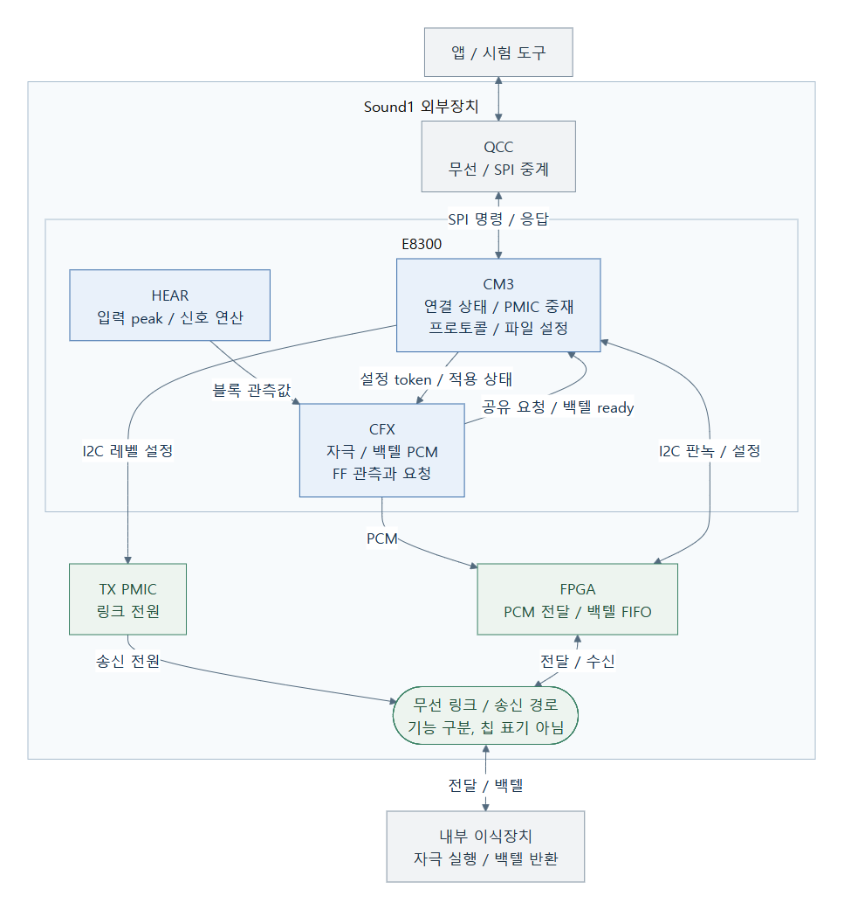
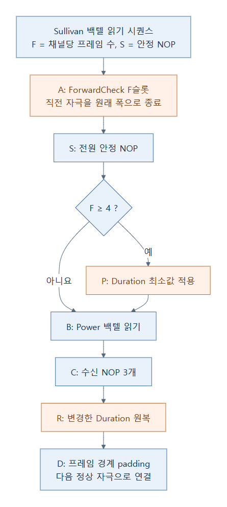
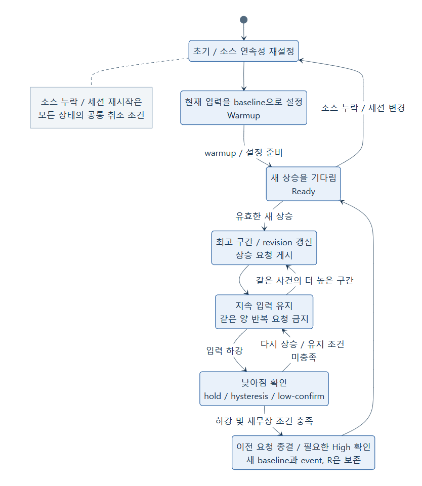
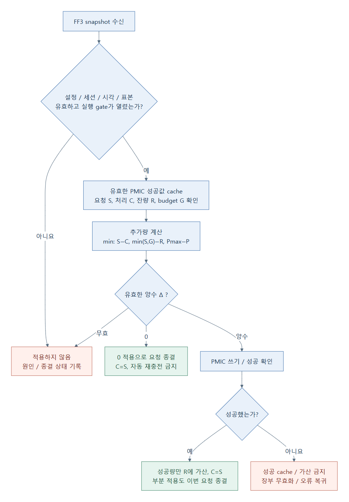
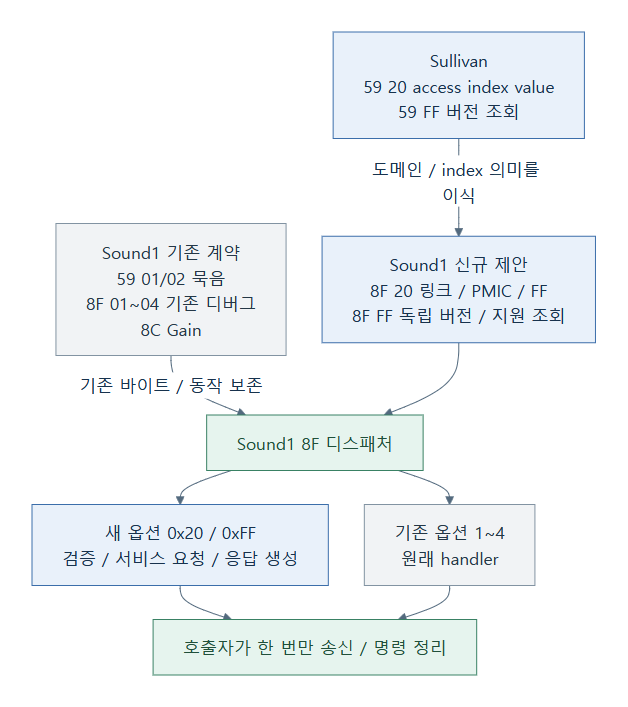
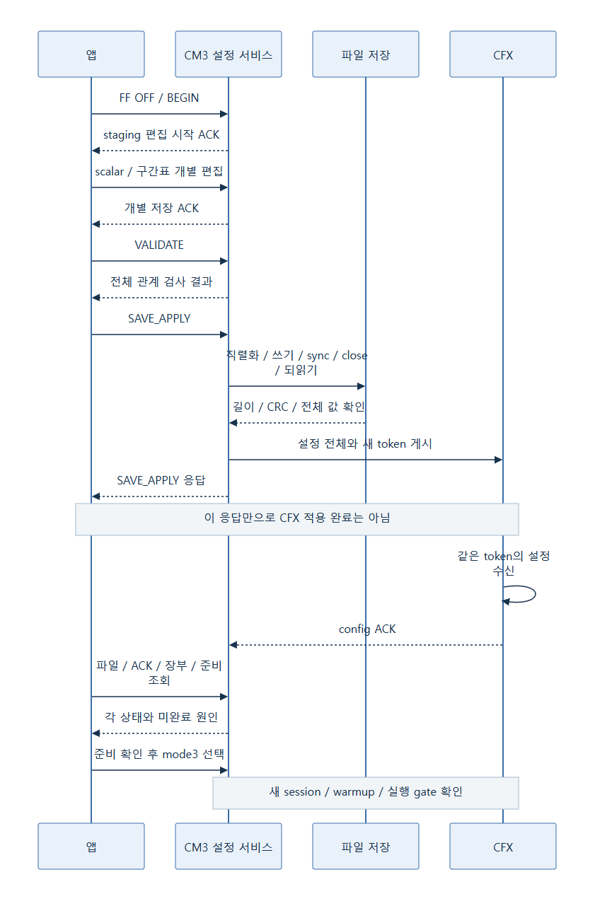
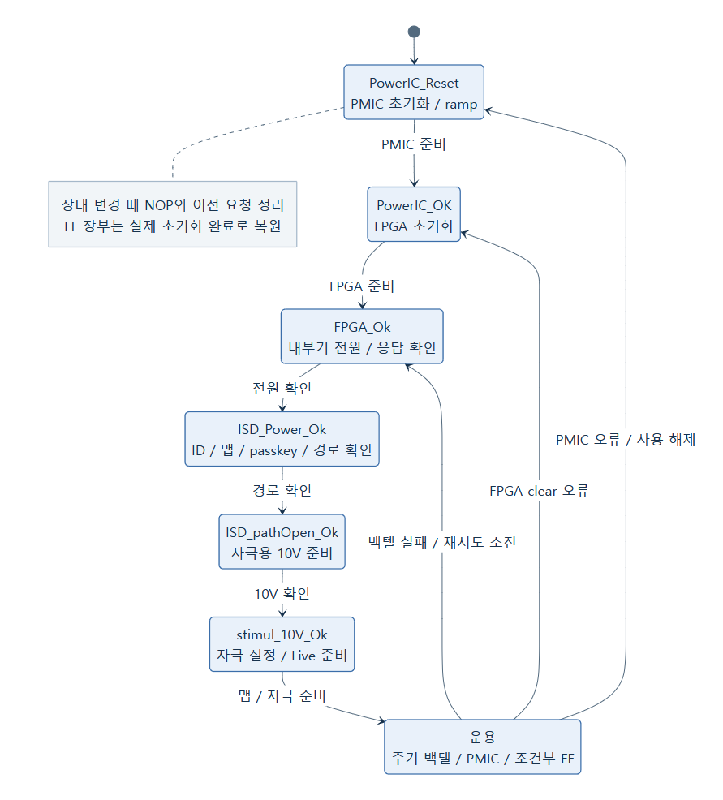
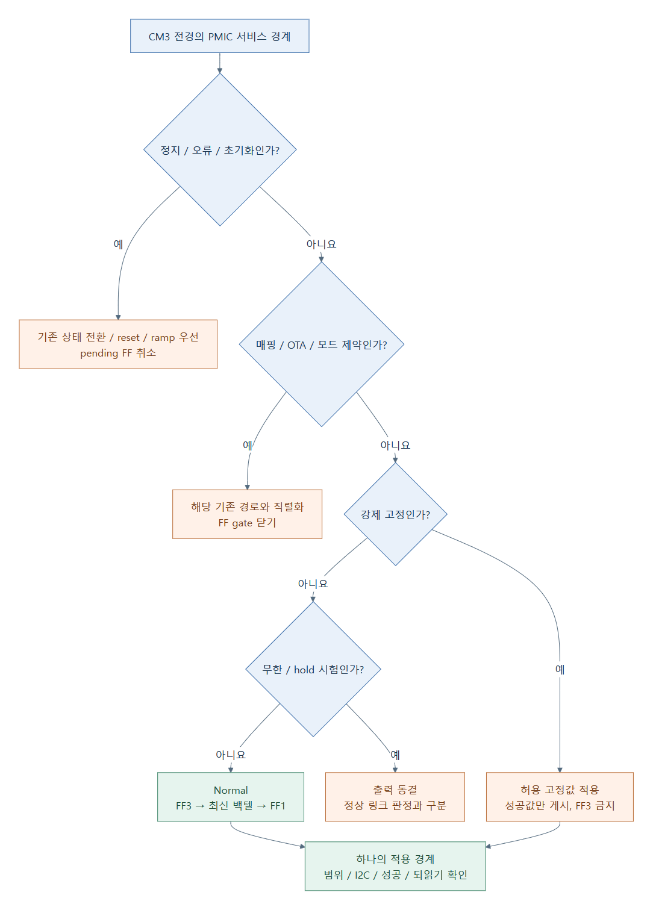
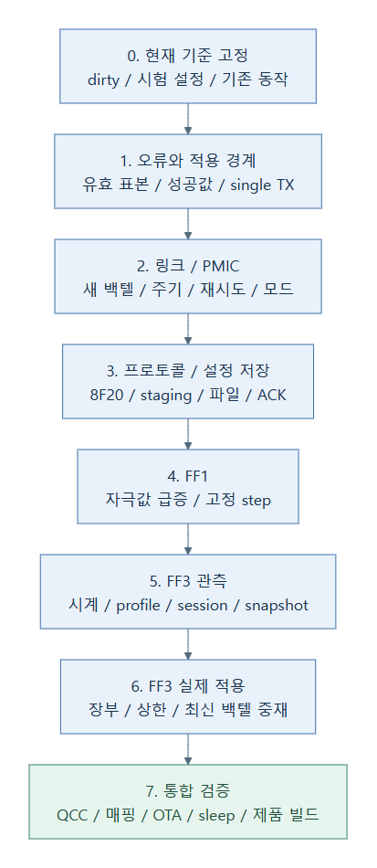

# Sullivan의 링크 확인, PMIC 및 FF를 Sound1으로 이식하는 분석과 계획

**1차 구현 목표는 현재 Sound1 코드를 최대한 유지하면서 Sullivan의 링크·백텔·PMIC 기능만 병합하는 것이다.** 2026-10-19 사용자 지정에 따라 설정 가능한 운영 하한의 최저는 **2.8V(112)**, Normal 하한의 기본값은 **3.5V(140)**, Mapping 하한의 기본값은 **4.3V(172)**로 정한다. 백텔 주기는100ms 단위, 기본300ms이며 Normal/Live의 기본 재시도는1coin이다. **FF1/FF3 구현은 후속 범위**로 분리하고 확장할 수 있는 PMIC 적용 경계·프로토콜 번호·공유 ABI 관리만 준비한다.

FF는 **feedforward, 즉 신호가 커지는 것을 보고 전원을 미리 보정하는 기능**이다. 프로토콜의 `0xFF` 바이트는 별도의 버전 조회 옵션이므로 두 의미를 구분한다.

[기능별 탭 HTML로 읽기](마이그레이션%20분석.html): 링크·백텔, PMIC, FF1/FF3, 프로토콜, 공유·저장, 이식·검증을 나누어 보고 반응형 도해와 FF3 계산 예시를 사용할 수 있다. HTML의 도해는 글자와 상자를 직접 재배치하므로 별도 확대 창이 필요하지 않다. 분석 내용의 원본은 이 Markdown이다.

이번 이식의 대상은 은수님이 확인한 **`sound1-fw-e8300-backup`의 현재 작업본**이다. 이 문서는 코드 분석과 구현 계획이며, 펌웨어나 PMIC 설정을 변경한 결과가 아니다. 제안 그림은 미구현 설계안으로 표시했다. 실제 장치의 전압/전류, 링크 안정성 및 전원 차단 복구 시험은 수행하지 않았다.

## 읽는 순서

| 알고 싶은 내용 | 위치 |
|---|---|
| 무엇을 옮기고 무엇을 유지하는가 | [1장 권장 범위](#scope), [2장 코어별 역할](#architecture) |
| 백텔 확인 방식이 무엇이 다른가 | [3장 백텔과 PCM](#backtel) |
| PMIC를 언제 올리고 내리는가 | [4장 전원 정책](#power) |
| FF1과 FF3는 어떻게 다른가 | [5장 FF1](#ff1), [6장 FF3](#ff3) |
| 코어 사이의 정보와 시간이 어떻게 맞는가 | [7장 공유 메모리와 시간](#shared) |
| 기존 앱 명령과 어떻게 공존하는가 | [8장 프로토콜](#protocol) |
| 설정 저장과 실제 적용은 언제 끝나는가 | [9장 설정 트랜잭션](#config) |
| 상태 전이와 수정할 파일은 무엇인가 | [10장 상태와 중재](#states), [11장 단계와 파일](#implementation) |
| 어떤 시험으로 이식 성공을 판단하는가 | [12장 검증 계획](#verification) |
| 아직 결정하거나 확인할 것은 무엇인가 | [13장 결정과 위험](#decisions), [14장 근거](#evidence) |

<a id="scope"></a>
## 1. 이식 범위와 기준

> 2026-10-19 후속: 기준 통합 `91172db1` 뒤 새 브랜치에서 FF를 제외한1차 코드를 구현했다. 현재 패킷/기본값/빌드·실기 절차는 [빌드와 실기 확인](빌드와%20실기%20확인.md)을 사용한다. 아래14장은 구현 전에 작성한 분석·제안과 후속 FF 설계를 보존한 기록이며, 신규 Sound1 프로파일의 펄스폭 개별 읽기는2바이트다. 근거 링크는 통합 뒤 현재 경로로 연결했다.

### 1.1 파일 전체를 덮어쓰면 안 되는 이유

Sound1에도 이미 CFX가 백텔 확인용 PCM을 만들고 CM3가 백텔 결과에 따라 PMIC를 조절하는 기능이 있다. Sullivan은 여기에 런타임 파라미터, 다른 백텔 패킷 배치, 재시도 정책, FF1/FF3 및 설정 저장을 추가한 계열이다.

두 프로젝트의 파일 이름이 같아도 현재 Sound1에는 QCC 연계, NofM, 알림, 터치/LED 및 시험 훅이 들어 있다. 따라서 같은 이름의 `isd_interface.c`나 `stimulationStrategy.c`를 복사하면 현재 변경을 잃거나 새 제어가 기존 제어와 동시에 PMIC를 쓸 수 있다.

| 기능 묶음 | 권장 처리 | 이유 |
|---|---|---|
| 내부기 초기화/연결, 맵 적용, Live 진입 | Sound1 흐름 유지 | QCC 알림과 실제 자극 허용 순서가 여기에 연결됨 |
| 백텔 PCM 생성과 runtime 주기 | Sullivan 동작을 별도 변경 단위로 이식 | 시퀀스, 프레임 가드, 완료 게시를 함께 검증해야 함 |
| PMIC 파라미터와 제어 정책 | 접근자와 중재 흐름을 이식 | 자동/고정/재시도/FF가 같은 실제 출력을 제어함 |
| FF1 | 후속 범위. 감지와 CM3 적용을 나중에 함께 이식 | 1차에는 CFX flag와 PMIC 가산을 넣지 않음 |
| FF3 | 후속 범위. 관측/시계/공유/장부/저장을 나중에 함께 이식 | 1차에는 확장 경계만 준비하고 실제 기능은 넣지 않음 |
| 범용 디버그 | 기존 `8F 01..04` 유지, 새 `8F 20` 추가 | 기존 옵션과 의미가 충돌하지 않도록 함 |
| Sullivan 전용 핀 마커/로그 | 선택 진단으로 분리 | Sound1 핀 사용과 실행시간을 별도로 확인해야 함 |
| Sullivan nRF/배터리 도메인 | 이번 필수 범위에서 제외 | Sound1은 QCC 연계와 다른 상태 공급 경로를 사용함 |

### 1.2 분석은 HEAD와 현재 작업본을 함께 기준으로 한다

확인일은 2026-10-19다. 경로는 현재 PC의 실제 위치이며 다른 PC에서는 달라질 수 있다.

| 항목 | Sullivan 원본 | Sound1 대상 |
|---|---|---|
| 저장소 | `E:\workspace\projects\sullivan-1-5-fw-hw-test-link-pwr-bt-period` | `E:\workspace\projects\sound1-fw-e8300-backup` |
| HEAD | `e73fa77b66dd5b5af51fce29524ff791df4070a8` | `57d71179ebe7d3ea537918ab7385734327e9673c` |
| 실제 입력 | HEAD + 관련 미커밋 변경 | HEAD + 관련 미커밋 변경/시험 소스 |
| 보드/FPGA 선택 | OTE 1.5 / FPGA 2.7.0 | OTE 1.5 / FPGA 2.7.0 |
| 내부기 선택 | ISD 1.1.2 | ISD 1.1.2 |
| 이번 확인 수준 | 코드, 빌드 정의, 문서 대조 | 코드, 빌드 정의, 구조 근거 대조 |

Sound1의 [시스템 구조 원본][system]에서 시작해 해당 파일/심볼을 대조했다. 구조 근거 확인 도구는 97개 파일 모두 기준 해시와 일치했다. 이 결과는 파일 동일성 검사이며 실기 통과가 아니다.

특히 Sullivan의 현재 dirty 설정은 과거 설명 및 HEAD와 다르다. 현재 Normal 하한은 **140**, FF3 budget은 **20**, 인접 구간 증가량은 **`0,4,4,4,4,4`**, verbose 출력은 **0**이다. 과거의 하한112나 budget11을 현재값으로 복사하지 않는다. 유효한 설정 파일이 있으면 실제 실행값은 파일에 따라 다시 달라질 수 있다.

세부 작업 상태와 조사 분담/검증 결과는 [작업 기록](작업.md), 그림 원본은 [그림 목록](그림/README.md)에서 찾을 수 있다.

### 1.3 사용자 지정에 따른 1차 범위 개정

이번 개정은 전체 구조를 다시 만드는 계획이 아니라 기존 계획에서 **링크·전원과 FF를 분리**하는 것이다. 아래 값은 사용자가 지정한 이식 목표이며 실제 펌웨어에 이미 반영된 값이나 실기 합격값이 아니다.

| 설정/동작 | 1차 목표 | 의미와 경계 |
|---|---|---|
| 설정 가능한 운영 하한의 최저 | 112 = 2.8V | Normal/Mapping 하한과 디버그 고정값의 입력 검증에 적용. 초기화 reset75까지 금지한다는 뜻은 아님 |
| Normal 하한의 기본값 | 140 = 3.5V | 전원 여유가 있을 때 감소를 멈추는 기본값. 기동 직후 무조건3.5V로 출력한다는 뜻은 아님 |
| Mapping 하한의 기본값 | 172 = 4.3V | 매핑 IDLE, Live, Standby의 조정 경로에서 동일한 별도 하한 사용 |
| 상한의 기본값 | 214 = 5.35V | 기존 값 유지. runtime 상한은 두 하한보다 커야 하며214를 넘지 않음 |
| 백텔 주기 | 1~255 ×100ms, 기본3=300ms | CFX Live뿐 아니라 CM3 Mapping IDLE/Standby의 검사 재시작 시점에도 연결 |
| 상승/하강 | 기본 +4 / −1 | Low/High의 Stable·Unstable을 함께 반영하는 donor 정책. 상·하한 clamp |
| 재시도 coin | Normal/Live 기본1, 설정0~100 | 유효한 정상 백텔에서 설정 개수로 재충전.255 무한은 별도 시험 상태 |
| 기본 제어 모드 | 전원 상태 모드0 | 수신 여부 모드1/가속, 고정/무한은 donor의 선택 기능으로 유지, 기본 비활성 |
| FF | 미구현·항상 비활성 | 모드1/3 요청을 실행하지 않음. FF 전용 파일·TIMER0·표본/장부는 1차에 넣지 않음 |

2.8V는 칩 데이터시트의 새로운 물리 한계를 선언하는 값이 아니라 **이번 Sound1 운영 설정에서 받기로 한 최저값**이다. reset75=1.875V와 기동 ramp는 별도 초기화 경로로 유지한다. Normal/Mapping 하한은 각각 `112 ≤ 하한 < 유효 상한`, 고정은 `0=해제` 또는 `112..214`로 구분하고, 파일 복원에도 같은 관계 검증을 적용한다.

Sullivan과 동일하게 옮기는 것과 원본의 미비까지 그대로 두는 것은 다르다. 원본도 Mapping 전용 백텔에는 coin이 없고 IDLE/Standby 주기는 일부 고정300ms다. 이번 기본 계획은 **Normal/Live coin 동작은 원본과 동일**, **Mapping 전용 실패는 원본처럼 재초기화**, **설정 주기는 Mapping 진입점에도 일관되게 반영**하는 안이다. Mapping 전용에도1coin을 적용하는 것은 별도 정책 변경이며 확정된 요구로 취급하지 않는다. 임피던스/eCAP 등의 측정 동안 별도 주기 검사를 쉬는 기존 동작은 보존한다.

<a id="architecture"></a>
## 2. 전체 구조: CFX는 필요를 계산하고 CM3는 전원을 조정한다



그림 1. 현재 역할과 이식할 기능의 위치. FF 모듈은 이식 대상이며 그림이 구현 완료를 뜻하지 않는다.

백텔은 내부기가 돌려보내는 정보다. CFX가 PCM에 조회 시퀀스를 넣으면 FPGA/무선 링크를 거쳐 내부기로 전달되고, CM3는 FPGA의 백텔 FIFO를 읽는다. 이 백텔의 내부기 전원 상태는 QCC가 알려주는 외부장치 배터리 잔량과 다른 정보다.

FF는 백텔 응답을 기다리는 제어보다 앞에서 전원 상승의 필요를 추정한다. 그래도 PMIC를 쓰는 주체는 CM3다. CFX의 오디오 처리에서 직접 I2C 쓰기를 추가하는 방식으로 옮기지 않는다.

| 주체 | 현재 또는 이식 후 책임 | 확인할 경계 |
|---|---|---|
| CFX/HEAR | 입력 블록과 자극값 계산 | FF3는 AGC 적용 전 peak, FF1은 계산된 자극 amplitude를 사용 |
| CFX | 백텔 PCM 배치, FF 요청 게시 | 자극 프레임/Duration 보존, 설정 token과 표본 일관성 |
| CM3 | 내부기 연결 상태, 결과 판독, PMIC 중재 | 매핑/OTA/맵 변경/절전과 겹치지 않게 처리 |
| PMIC | 레벨 코드에 따른 출력 | 요청값, 실제 쓰기 성공값, 되읽은 값, 실측 전압을 구분 |
| FPGA/내부기 | 명령 전달과 백텔 | FIFO 개수, 수신 데이터, I2C 실패를 별도 판정 |
| QCC/앱 | 무선 명령 전달과 UI | 기존 명령 호환, 길이 보존, 순차 요청, 설정 완료 상태 표시 |

Sound1 CM3의 정상 순서는 `systemControl → update_mapNum → isd_interface → bleCommunication`이다. 따라서 BLE에서 설정을 받은 그 회차에는 이미 링크 서비스가 끝났을 수 있다. ACK를 “그 순간 실제 전압까지 바뀌었다”는 뜻으로 정의하면 안 된다. [근거: Sound1 main][t-main], [내부기 제어][t-isd]

<a id="backtel"></a>
## 3. 백텔 링크 확인: 공통 골격과 실제 차이

### 3.1 현재 Sound1의 골격

CFX는 Live PCM에서 자극 데이터를 먼저 만든 뒤 백텔 시퀀스로 일부를 덮는다. 카운터는 초기 `-300`에서 시작하며 정상 주기에는 다음 단계를 진행한다.

| 카운터 | CFX 동작 |
|---:|---|
| 0 | 백텔 회로 enable 패킷 생성 |
| 1 | 내부기 Power 조회와 Backtel NOP 생성 |
| 2 | 백텔 회로 disable 패킷 생성 |
| 3 | 대기 |
| 4 | CM3에 결과 판독 준비 상태 게시 |

CM3는 ready를 보고 FPGA FIFO/내부기 전원 상태를 읽고, PMIC를 읽은 뒤 조절하고 FIFO와 ready를 정리한다. 현재는 여러 CM3 회차에 나누어 처리한다.

Sound1의 주기 상수는 300이지만 증가식이 `0..300`을 돌기 때문에 enable 사이에는 **301회의 Live 함수 호출**이 있다. Live가 매 1ms에 한 번 실행된다는 전제에서는 약301ms다. 호출 누락이나 대기가 있으면 벽시계 시간과 다르다. Sullivan도 이 증가식이 있어 runtime 300ms 설정을 정확히300ms 실측 보장으로 설명하면 안 된다.

### 3.2 Sullivan의 PCM 배치



그림 2. Sullivan 최신 시퀀스의 코드상 순서. 실제 파형이나 측정 화면이 아니다.

Sullivan은 단순히 읽기 요청과 NOP만 넣지 않는다. `F`를 채널당 자극 프레임 수, `S`를 전원 안정 NOP 개수라 하면 다음 순서다.

1. **ForwardCheck, F슬롯:** 직전 자극을 원래 펄스폭으로 끝내는 경계를 보존한다.
2. **안정 NOP, S개:** 내부기 전원과 백텔 준비를 위한 구간이다.
3. **Duration 최소값 적용:** F≥4일 때 수행한다. ForwardCheck보다 앞에서 바꾸지 않는다.
4. **Power 백텔 읽기:** 프레임 조건에 맞춰 읽기 패킷을 배치한다.
5. **수신 NOP 3개:** 백텔 수신 구간이다.
6. **Duration 원복:** 이후 자극이 원래 폭으로 나가게 한다.
7. **프레임 경계 padding:** 다음 자극과의 경계를 맞춘다.

기본 안정 NOP 표와 padding 전 소계는 다음과 같다. 소계 식은 F≤3에서 `2F+S+3`, F≥4에서 `F+S+6`이다.

| F | 기본 S | padding 전 소계 |
|---:|---:|---:|
| 1 | 3 | 8 |
| 2 | 3 | 10 |
| 3 | 3 | 12 |
| 4 | 2 | 12 |
| 5 | 4 | 15 |
| 6 | 6 | 18 |
| 7 | 1 | 14 |
| 8 | 2 | 16 |
| 9 | 3 | 18 |

PCM은 1ms 블록당24슬롯이다. 설정한 S는 여유 슬롯에 따라 추가로 제한된다. Enable 설정 슬롯19와 Disable 설정 슬롯1의 배치로 코드상 회로 ON 구간은30슬롯, 즉 `30 × 1ms/24 = 1.25ms`로 계산된다. 이는 패킷 배치 계산이며 실제 핀 전압/안정화 효과를 측정한 값이 아니다.

Duration 변경이나 복원을 빠뜨리면 다음 자극 폭이 달라질 수 있다. 이 때문에 코드 일부를 복사하는 대신 **ForwardCheck부터 복원/padding까지 한 시퀀스로 검증**해야 한다. [근거: Sullivan PCM][s-pcm-live], [Sound1 PCM][t-pcm-live]

### 3.3 프레임 가드가 다르므로 그대로 옮기면 기능이 줄어든다

| 항목 | Sound1 현재 | Sullivan 최신 |
|---|---|---|
| 백텔 읽기 가드 | F>12이면 읽기/ready 생략 | F≥10이면 읽기/ready 생략 |
| 주기 | 상수300, 실제301회 호출 | 1~255의100ms 단위 설정, 같은 증가식 |
| 안정 NOP | 기존 프레임 분기 | 표 기반 기본값 + override + FIFO 여유 제한 |
| Duration 전환 | 기존 배치 | F≥4의 명시적 최소/복원 순서 |

따라서 **F10~12에서 새 시퀀스를 조용히 생략하게 만들면 안 된다.** 초기 권장안은 F1~9에 새 시퀀스를 적용하고, F10~12는 검증된 기존 경로를 유지하는 fallback을 두는 것이다. fallback의 실제 유지 가능성과 겹치는 버퍼 범위는 구현 단계에서 확인한다. FF3는 F1~9로 제한한다.

기존 경로도 사용할 수 없는 프레임 구성은 “최근 링크 확인 불가”로 명시해야 한다. 검사 생략을 수신 성공이나 연결 유지의 근거로 쓰지 않는다. fallback 대신 맵을 거부하는 안을 선택한다면 Live 진입 전에 명확히 거부해야 하며, 이는 제품 동작 변경 결정으로 별도 기록한다.

### 3.4 producer와 consumer 사이의 중복 방지

현재 Sound1의 공유 상태는 `0=clear, 1=enabled, 2=ready`다. CFX는 다음 주기 시작 때 CM3의 이전 clear를 반드시 기다리는 구조가 아니다. 주기를100ms로 줄이거나 파일 저장으로 CM3가 지연되면 이전 결과와 새 요청이 겹칠 수 있다.

이식 때는 기존 상태에 검사 순번/ACK를 추가하거나, 이전 검사가 미완료이면 새 검사를 시작하지 않는 유한 대기와 timeout을 둔다. timeout은 PCM을 무한히 점유하지 않게 정리하고 “오래된 백텔”을 새로운 판정에 사용하지 않아야 한다. 이 부분은 권장 보완 설계이며 이미 양쪽에 완성돼 있다는 뜻은 아니다.

<a id="power"></a>
## 4. PMIC 레벨과 링크 판정 정책

### 4.1 레벨 코드를 실측 전압과 구분한다

두 코드의 ISL9122 주소는 `0x18`, VoltageSet 레지스터는 `0x11`이다. 아래 전압은 코드 주석식 `V=0.025 × level`로 계산한 값이다. 실제 보드 허용 전압이나 실측 결과를 대신하지 않는다.

| 항목 | Sound1 작업본 | Sullivan 작업본 | 이식 권장 |
|---|---:|---:|---|
| 설정 하한의 최저 | 별도 새 정책 필요 | validator72부터 허용 | **사용자 지정112 → 2.80V**로 입력/파일 검증 |
| Normal 하한 | 164 → 4.10V | 140 → 3.50V | **기본140 → 3.50V** |
| Mapping 하한 | 기존 동일 상수 경로 중심 | 별도172 → 4.30V | **기본172 → 4.30V**, 전용/Live 양쪽 반영 |
| 상한 | 214 → 5.35V | 하드웨어214, runtime 상한 별도 | 첫 단계214 유지, 변경 범위 검증 |
| reset | 75 → 1.875V | 75 → 1.875V | 초기화 전용 값으로 구분 |
| 초기 ramp step | 5 → 125mV | 5 → 125mV | 초기화 순서를 별도로 유지 |
| Live 조정 | Stable에만 ±1 | Low에 설정 step, High에−1 | 동작 변경을 시험으로 확인 후 적용 |

Sound1 `MinTxPowerValue=164` 옆의 “160=4V” 주석은 현재 상수와 다르다. 현재값은4.10V로 계산하며, 이식 목표140=3.50V와 구분한다. 운영 설정 최저112와 Normal/Mapping 기본140/172는 사용자 지정이다. 이 설정의 Sound1 보드 실측 및 donor FF 입력 보정표의 적합성까지 확인된 것은 아니다. [근거: 대상 PMIC 정의][t-pmic-h], [소스 PMIC 정의][s-pmic-h]

reset75는 새 설정 최저112보다도 낮다. 따라서 모든 쓰기를 단순히 `112..214`로 clamp하면 초기화가 깨진다. **초기화 reset/ramp의 허용 범위와 운영 설정의 허용 범위를 구분**한다. 디버그 고정값도 0해제 또는112~214로 검증하며, donor의72~214 validator를 그대로 가져오지 않는다.

### 4.2 전원 상태 모드0

| 백텔 결과 | Sound1 현재 | Sullivan 모드0 |
|---|---|---|
| LowUnstable=0 | 유지 | 설정 step만큼 상승 |
| LowStable=1 | 상한까지 +1 | 설정 step만큼 상승 |
| HighUnstable=2 | 유지 | 하한까지 −1 |
| HighStable=3 | 하한까지 −1 | 하한까지 −1 |
| NoBacktel=4 | 오류/FPGA_Ok 재초기화 | coin 있으면 소모하고 상승/재시도, 없으면 재초기화 |
| TooMuch=5 | 오류/재초기화 | coin 재시도에서는 상승하지 않음 |

Sullivan의 상승 step 기본은4, 즉 코드상100mV다. 이는 Sound1의 기존25mV 상승과 다르고 Unstable도 반영한다. 같은 이름의 “전원 상태 판정”이어도 결과가 같지 않다. 단계별 시험에서는 기존 동작과 이 의도된 변경을 구분한다.

coin은 허용 재시도 횟수다. Sullivan 설정은0~100, 기본1이며 정상 백텔에서 다시 충전된다.255는 무한 모드다. **무한 재시도는 연결이 정상이라는 뜻이 아니며**, 별도 시험 기능으로 구분한다.

### 4.3 수신 여부 모드1

Sullivan 링크 제어 모드1은 Low/High의 의미를 쓰지 않고, 정상 백텔1개 수신이면−1, 미수신이면 상승한다. FF mode1과 번호가 같지만 다른 설정이다.

연속 실패 가속을 켜면 기본 step4 기준 상승량은 `4,4,8,8,12,12,16,16,...`이다. 현재값이 상한에 도달한 뒤 다음 실패에서 끊김을 판정한다. TooMuch는 경고/전압 유지/연속 실패 초기화다. 매핑에는 적용하지 않는다.

현재 donor 하한140에서214까지 가속 ON이면 `140→144→148→156→164→176→188→204→214`로8회 상승하고, 상한에서의 다음 미수신을 포함해 총9회 판정이 필요하다. OFF이면19회 상승과 다음 실패로 총20회다. 시작 전압, 주기 및 고정 모드에 따라 결과가 달라진다. 이 시험용 탐색 방식을 처음부터 Sound1 제품 기본으로 바꾸는 것은 권장하지 않는다.

### 4.4 고정 출력, 무한 모드, 안전 기동

Sullivan의 우선순위는 다음과 같다.

- 강제 고정이 있으면 지정 레벨이 우선한다.
- 고정이 없고 무한 모드이면 현재 레벨을 동결한다.
- 둘 다 없으면 일반 피드백과 FF 조건을 적용한다.

고정값이 상한보다 낮은 상태에서 수신 여부 모드를 쓰면 매번 고정값으로 돌아가 상한에 도달하지 못하고 끊김 판단이 지연될 수 있다. 고정/무한과 FF3는 함께 동작시키지 않는다.

Sullivan safe boot는 첫 연결까지 파일에 저장된 낮은 상한을 무시하고214로 초기화한다. 최초 연결 후 파일 상한을 허용하지만 그 순간 현재 전압을 갑자기 낮추지는 않는다. Sound1에서는 이식 여부와 함께 재연결/재부팅 시 고정값과 runtime 상한의 수명을 명시해야 한다.

1차 기본 조합은 **전원 상태 모드0, 고정 해제, 무한 해제, FF 미구현/비활성**, 설정 최저112, Normal 기본140, Mapping 기본172, 상한214다. 기존164 기반 동작은 변경 전 회귀 기준으로 기록하고, 새 기본값에서의 결과와 의도된 차이를 비교한다. Mapping 진입 때 현재 성공값이172보다 낮으면 해당 경로에서 하한까지 올리고 성공/오류를 확인하며, Normal 복귀 때140으로 즉시 강제 하강시키지 않는다.

<a id="ff1"></a>
## 5. FF1: 계산된 자극값의 급증을 보고 작은 폭으로 올리기

**후속 확장 참고: 이 장의 감지·pending·PMIC 가산은 1차 구현 대상이 아니다.** 아래는 나중에 FF를 연결할 때 보존할 donor의 계약이다.

FF1은 CFX가 계산한 자극 amplitude 합을 본다. CIS에서는 활성 밴드, NofM에서는 선택된16개의 합을 사용한다. 직전 채널당 평균값에 따라 기본 임계 비율이5/10/15/20%로 달라지고, 증가율이 임계를 **초과**하면 상승 flag를 게시한다.

| 직전 채널당 평균 | 기본 임계 |
|---|---:|
| 0~63 | 5% |
| 64~127 | 10% |
| 128~191 | 15% |
| 192~255 | 20% |

기본 cooldown은50ms, CM3의 FF 상승 step은1이다. 맵/볼륨 변경 직후에는 비교를 한 번 건너뛰어 설정 변경을 소리의 급증으로 오인하지 않게 한다.

**계산 예:** CIS32채널에서 직전 합1600, 이번 합1760이면 직전 평균은50이고 증가율은10%다.5%를 넘으므로 요청한다. 현재 PMIC가180이고 조건이 맞으면181로 상승한다. 코드식 전압은4.500V에서4.525V로 바뀐다. 이후 실제 High 백텔과 일반 제어에 따라 내려갈 수 있다.

CFX flag는 boolean이므로 모든 사건을 누적하는 큐가 아니다. CM3는 flag를 가져와 pending으로 두고 I2C가 바쁘면 보류한다. Normal/연결/링크 모드0/고정 해제/무한 해제 조건에서만 적용하고, 되읽기와 쓰기 실패를 성공으로 기록하지 않는다.

FF1은 AGC/주파수 처리 뒤의 자극값을 보기 때문에, 입력 단계에서 급증을 보는 FF3보다 뒤에 위치한다. 어느 쪽이 실제 링크 안정성에 더 유리한지는 이번 정적 분석만으로 확정할 수 없다. [근거: Sullivan 자극 FF][s-strategy], [CM3 FF 서비스][s-isd]

<a id="ff3"></a>
## 6. FF3: 입력 소리의 상승 구간을 보고 필요한 만큼 선행 보정하기

**후속 확장 참고: 입력 보정·TIMER0·snapshot·ACK·장부·보상 적용은 1차 구현 대상이 아니다.** 링크·PMIC를 먼저 완성하며, 이 장의 수치는 현재 Sound1 FF 실행값으로 광고하지 않는다.

### 6.1 입력이 무엇인지 먼저 맞춰야 한다

FF3의 입력은 HEAR가 구한 **최근16표본의 혼합 입력 절대값 최대치**다. CFX `audio_agc()`가 AGC gain과 FFT 적용 전에 읽는다. raw 선형값이며, 그 자체가dB나 장시간 RMS가 아니다.

Sullivan은 전용 SPL↔raw 보정표를 사용한다. Sound1의 두 마이크/방향, QCC I2S, 스트리밍/크래들 혼합, gain, 텔레코일 등에서 같은 raw가 같은 음압을 뜻하는지 먼저 확인해야 한다. Sullivan의 표 ID1을 Sound1의 검증된 프로파일이라고 표시하지 않는다.

입력 소스나 맵/볼륨 조건이 바뀌면 이전 baseline과 비교하지 않도록 세션을 새로 시작해야 한다. 이때 “다음 사건을 받기 위한 기준값 초기화”와 “이미 올린 PMIC 잔량을 지우는 것”은 별개다.

### 6.2 현재 donor의 FF3 설정 예

다음은 현재 작업본의 **시험 기본표**이며 Sound1 보정 완료값이 아니다.

| 구간 | SPL 하한 | 인접 증가량 | 누적 요구량 S | 최고점 hold |
|---:|---|---:|---:|---:|
| 0 | 바닥 구간 | 0 | 0 | 40ms |
| 1 | 40dB | 4 | 4 | 40ms |
| 2 | 46dB | 4 | 8 | 40ms |
| 3 | 55dB | 4 | 12 | 50ms |
| 4 | 65dB | 4 | 16 | 60ms |
| 5 | 80dB | 4 | 20 | 80ms |

주요 시간/판정값은 warmup32ms, filter MA2, release EMA의N32, background250ms, soft/hard rise6/12dB, 상승 확인2블록, low-confirm24ms, 하강 hysteresis1dB다. 요청/heartbeat TTL은 각각4ms, 쓰기 최소 간격1ms, 보상 budget20, High 정보 최대 나이400ms다. 각 설정의 단위를 그대로 보존해야 한다. `N32`는32라는 필터 계수이며 모든 상태 지연을 정확히32ms로 보장하는 값이 아니다.

### 6.3 CFX 입력 상태기계



그림 3. Sullivan FF3 입력 상태를 이해하기 위한 요약. 예외/검증은 본문과 코드 근거를 함께 따른다.

시작할 때 이미 큰 소리가 들어오면 그 소리를 baseline으로 삼아 warmup한다. 무음에서 새로 커진 사건으로 즉시 보정하지 않는다. 준비 후 최고 구간이 올라가면 revision을 갱신해 상승 요청을 낸다. 큰 상승/무음 탈출과 작은 상승의 확인 조건은 다르다.

지속 소음에서는 매ms 같은 양을 반복 가산하지 않는다. 충분히 낮아지고 hold/hysteresis/low-confirm 및 필요한 최신 High 확인을 통과하면 새 baseline과 event로 재무장한다. 1ms source tick이 연속되지 않으면 이전 사건/요청을 이어 쓰지 않고 새 event/revision과 warmup으로 이동한다. **재무장은 다음 상승을 새 사건으로 인정하는 과정이며, PMIC를 낮추는 동작은 아니다.** [근거: FF3 입력 상태기계][s-agc]

### 6.4 CM3는 요청을 그대로 더하지 않는다

요청이 도착해도 다음 조건을 확인한다.

| 조건 묶음 | 필요한 상태 |
|---|---|
| 동작 범위 | FF3 선택, Normal, 링크 모드0, 연결/10V 준비/Live |
| 자극 구성 | 자극음량과 오디오음량>0, CIS 또는 NofM, F1~9 |
| 제어 충돌 방지 | 강제 고정/무한 해제, 유효한 PMIC 장부 |
| 설정 일치 | CFX가 현재 설정 token을 ACK, 같은 세션 |
| 요청 유효성 | warmup 완료, 일관된 snapshot, heartbeat/request 신선도, 표와 누적 요구량 일치 |
| 하드웨어 접근 | 유효한 독립 시계, I2C 사용 가능, 유효한 PMIC 성공값 cache |

따라서 앱에 표시하는 `mode=3`과 “현재 보정 가능/실제로 적용 중”은 다른 상태다. 적용 불가 원인도 조회 가능하게 해야 한다. donor의 FF3는 매 요청마다 PMIC를 다시 읽지 않고 공통 읽기/쓰기 성공 때 갱신한 cache를 사용한다. 최신 되읽기는 백텔 phase2의 조절과 묶여 있다. 요청마다 새 I2C 읽기를 추가한다면4ms TTL과 지연을 바꾸는 별도 설계 변경으로 검증해야 한다.

### 6.5 보상 장부: 이미 올린 양과 이번 사건을 따로 기억

Sullivan은 다음 값을 구분한다.

| 기호 | 의미 |
|---|---|
| P | 현재 PMIC 레벨 코드 |
| Pmax | 현재 정책의 유효 상한 |
| S | 이번 사건 최고 구간의 누적 요구량 |
| C | 이번 사건에서 이미 처리/종결한 누적 요구량, 코드의 `processed_total` |
| R | 성공한 FF 상승에서 성공한 Normal High 하강을 뺀 보상 잔량 |
| G | 허용 보상 budget |

유효성 검사 후 양수 적용량을 다음 세 한도 안에서 계산한다.

```text
미처리 요청        = S − C
보상 잔량의 여유   = min(S, G) − R
현재 전압의 여유   = Pmax − P

추가량 Δ = 세 여유의 최솟값
여유가 없거나 요청이 이미 처리됐으면 Δ=0
값/상태가 무효이면 적용하지 않고 별도 오류로 처리
```



그림 4. FF3의 핵심 적용 흐름. 무효 요청, 통신 실패, 0적용의 의미를 구분한다.

**계산 예1, 같은 사건의 연속 상승:** P180, R0, C0, G20, Pmax214에서 구간3의 S12를 받으면 Δ12다. 실제 쓰기 성공 후 P192, R12, C12가 된다. 같은 사건에서 구간5의 S20으로 오르면 차액8만 적용해 P200, R20, C20이 된다. 같은 구간5가 계속돼도 추가량은0이다. 코드식 전압은4.50→4.80→5.00V이며, 실제 측정 예가 아니다.

**계산 예2, 상한 때문에 부분 적용:** P210, R0, C0에서 S12를 받아도 상한214 때문에4만 올린다. 성공 후 R4가 되지만 **C는12로 종결**한다. 나중에 전압 여유가 생겨도 같은 요청의 나머지8을 자동으로 재충전하지 않는다.

**계산 예3, High로 잔량을 회수:** 예1 뒤에 Normal High에 의해 P200→199의 쓰기가 실제 성공하면 R20→19가 된다. 같은 사건의 C20은 그대로이므로 동일 요청이 다시1을 채우지 않는다. 새 사건이 시작돼도 R을0으로 지우지 않는다.

새 사건에서는 C를 새 baseline 구간의 누적량으로 설정하며 R은 유지한다. 새 사건, FF OFF, hold 종료, 설정 저장으로 R을 지우면 기존 상승분이 남아 있는데 다시 전체 budget을 쓸 수 있다. donor에서는 실제 PMIC 초기화가 끝난 `tdc_audio_ff_physical_init()`에서만 R0/valid를 복원한다. mode1/매핑/고정/무한/되읽기 불일치/I2C 실패 등은 장부를 무효화할 수 있다. **FF1→OFF→FF3 전환만으로 준비 상태가 복구된다고 가정하지 않는다.** [근거: 장부 함수와 적용 서비스][s-isd]

### 6.6 백텔 High가 바로 직전 FF 상승을 취소하지 않게 한다

Sullivan 서비스 순서는 FF3 → 백텔 → FF1이다. FF3 백텔 처리에서는 PMIC 읽기와 조정을 같은 phase 호출에 둔다. 이전 회차에서 읽은 낮은 값으로 방금 올린 전압을 덮어쓰지 않기 위해서다.

같은 백텔 회차에 FF3가 실제 상승했다면, 상승 전 조건의 High 정보로 즉시−1하지 않는다. 이 경우 High를 이용한 R 회수/ACK도 하지 않는다. 이 순서와 신선도 검사를 함께 옮겨야 하며, 단순히 모든 High를 무시하는 기능으로 바꾸면 안 된다.

<a id="shared"></a>
## 7. 공유 메모리와 시간 기준을 함께 이식한다

1차에서는 링크 주기와 안정 NOP/override 등 실제 필요한 공유 필드만 기존 tail에 추가하고 양쪽 ABI를 확인한다. 아래 FF 설정/token/표본 계약과 TIMER0는 후속 설계다. 확장을 위해 지금부터 큰 FF 구조체·타이머·인터럽트를 예약/실행할 필요는 없다.

### 7.1 공유 구조체는 통째로 교체하지 않는다

Sound1의 CM3 공유 영역은 `.shared_memory`, CM3 관점 `0x00070000`이다. CFX는 IOMEM 창의 자기 주소 체계로 접근한다. 같은 구조체 이름이나 C 언어의 `int`라는 이름만으로 양쪽 실제 배치가 같다고 가정하면 안 된다.

| 묶음 | 생산자 → 소비자 | 유지/추가할 계약 |
|---|---|---|
| 기존 PCM 모드/SpecificCommand 버퍼 | CM3 → CFX, 일부 모드는 CFX도 갱신 | 준비 완료 후 게시, 소비 완료/다음 모드 전환 보존 |
| 기존 백텔 상태 | CFX → CM3 → clear | 검사 순번 또는 명시적 미완료 처리 추가 검토 |
| 링크 파라미터 | CM3 → CFX | 주기, 안정 NOP 및 override를 묶음으로 반영 |
| FF3 설정 | CM3 → CFX | generation/token, 재확인과 CFX ACK |
| FF3 입력 snapshot | CFX → CM3 | event/revision/session/시각/누적량을 같은 표본으로 읽기 |
| 적용/피드백 상태 | CM3 → CFX/앱 | 요청 종결, High 정보와 실제 성공 가산/회수 구분 |

신규 필드는 현재 Sound1 구조체 끝에 양쪽 같은 순서/표현으로 추가한다. 기존 필드 중간에 넣거나 donor 헤더로 교체하지 않는다. 실제 추가 바이트/워드 수, 정렬, 섹션 크기와 관련 타깃의 공유 구조를 map/ELF/생성 산출물로 확인한다.

### 7.2 설정 게시와 관측 게시의 방향이 다르다

Sullivan의 설정 게시 방법은 CM3가 token을0으로 무효화하고 전체 설정을 쓴 뒤 barrier를 거쳐 새 token을 게시하는 방식이다. CFX는 같은 token인지 다시 확인하고 자기 설정으로 가져온 뒤 ACK한다. **파일 generation과 공유 메모리 token은 별개**다.

CFX 관측은 작성 중 odd sequence, 완료 후 even sequence를 사용한다. CM3는 even을 확인하고24워드 snapshot을 복사한 뒤 sequence가 같은지 재확인한다. 중간에 바뀌었으면 그 snapshot을 사용하지 않는다. barrier, 접근 폭, 허용 재시도 횟수는 실제 CM3/CFX 툴체인에 맞춘다. `volatile`만 추가하는 것은 이 묶음 일관성을 대체하지 못한다.

이식안에서는 소스/맵/볼륨/링크의 수명 경계에 새 session을 부여한다. 설정 payload를 다시 게시할 때는 별도의 config token을 갱신하고 CFX ACK를 기다린다. donor의 기존 소스 전환 경로만으로 이 조건이 모두 충족된다고 가정하지 않는다. 구간별 진단 페이지는 여러 번 읽기 때문에 같은 시점의 한 snapshot이라는 보장은 없다. 진단에도 generation/event/revision을 함께 보고 서로 다른 페이지가 섞였는지 판정해야 한다. [근거: Sullivan 공유 정의][s-shared], [대상 공유 정의][t-shared]

### 7.3 TIMER0는 사용할 수 있는 후보지만 현재 실행 중이지 않다

Sound1의 현재 정상 소스 검색에서는 TIMER0의 직접 소유자/설정/IRQ 사용을 찾지 못했다. TIMER3는 LED/터치 등의 기존 tick이므로 그대로 유지한다. FF3를 위해 `ci_timer`의 기존 인스턴스를 TIMER0로 바꾸는 방식은 피한다.

| 항목 | 현재 Sound1 확인 | 이식 계획 |
|---|---|---|
| TIMER3 | `ci_timer`가 기존 기능에 사용 | 보존 |
| TIMER0 | 앱 소스에서 초기화/사용 경로 미확인 | FF3 전용 free-run 자원으로 명시적 초기화 |
| Normal SLOWCLK | 30.72MHz /24 = 1.28MHz | 정상 clock 설정 후 TIMER0 시작 |
| 활성 sleep SLOWCLK | 2.56MHz /2 = 1.28MHz | nominal 주파수가 같아도 FF는 sleep 진입 전 중지 |
| 타이머 단위 | SLOWCLK /32이면40kHz | 40count/ms, 1count=25us를 실제 카운터로 확인 |

Sullivan의 `source_tick`은1ms PCM 사건 순번이고 `source_wall`은 독립 하향 카운터다. **두 값은 단위가 달라 서로 빼면 안 된다.** CM3의 boolean iteration 횟수도 독립 벽시계를 대신하지 못한다.

donor는24비트 TIMER0에서 `0x7FFFFF`로 제한한 값을 사용한다. 같은 mask/40countms를 그대로 적용하면 관측값의 한 바퀴는 `2^23 /40 = 209,715.2ms`다. 실제 reload/COUNT 접근과 wrap 계산, 관측 간 최대 간격을 확인하고 sleep/restart/clock 불일치 때 표본을 폐기해야 한다. 단순히 현재 카운터를 읽는 함수만 이식하면 TTL이 동작하지 않는다.

권장 초기화 순서는 **Normal clock 설정 → TIMER0 초기화/검증 → FF 설정 게시 → CFX ACK → 새 session/warmup → 실행 gate 허용**이다. TIMER0 IRQ가 필요 없는 polling 설계라면 불필요한 IRQ를 켜지 않는다. 현재 소스에 사용처가 없다는 결과는 실제 장치/외부 바이너리의 점유까지 입증한 것은 아니다. [근거: 대상 timer][t-timer], [대상 clock][t-power-clock], [donor timer][s-timer]

<a id="protocol"></a>
## 8. 범용 디버깅 프로토콜은 헤더만 바꾸어 옮길 수 없다

1차 구현은 `8F20`의 링크/PMIC index0~16과 독립 버전/지원 조회가 중심이다. index17은 FF 미지원 상태를 읽기0으로 알리되 OFF 쓰기만 허용하고1/2/3은 거부하는 안을 사용한다. index18 이후 FF 설정/편집/schema/진단은 예약·미지원으로 명시하여 FF를 지원하는 것처럼 응답하지 않는다. 아래 전체 FF 인덱스와 schema3은 후속 확장의 번호/계약 참고다.

### 8.1 현재 명령의 의미



그림 5. 기존 명령을 보존하는 신규 도메인 제안. 신규 Sound1 명령은 아직 구현되지 않았다.

| 기능 | Sullivan | Sound1 현재 | 권장 Sound1 |
|---|---|---|---|
| 묵음 읽기/쓰기 | `59 01/02` | `59 01/02` | 유지 |
| 터치 진단 | 이번 이식 대상 아님 | `8F 01` | 유지 |
| OTA 상태 강제/백텔 무시 | 이번 이식 대상 아님 | `8F 02 value` | 의미와 응답 유지 |
| 맵 강제 초기화 | 이번 이식 대상 아님 | `8F 03 RL` | 유지 |
| fake sleep | 이번 이식 대상 아님 | `8F 04 mode` | 유지 |
| Gain 제어 | 이번 이식 대상 아님 | `8C ...` | 유지 |
| 링크/PMIC/FF | `59 20 ...` | 없음 | **`8F 20 ...` 추가** |
| 범용 버전/지원 조회 | `59 FF 00 00`, 버전4.6 | 없음 | **`8F FF 00 00` 추가** |

`8F 02`는 지금 OTA DFU 상태를 강제로 바꿔 백텔 판독을 우회하는 기능이다. 이를 donor의 무한 coin이나 새 링크 mode로 재해석하면 기존 앱이 다른 동작을 시킨다. 신규 option32(`0x20`) 안에 별도 index를 두어야 한다.

현재 Sound1 `0x8F`는 이미 remote 디스패치에 도달한다. 따라서 새 최상위 헤더를 등록하는 것이 주 작업이 아니라, `tdc_remote_general_debug_handle()`에 도메인을 추가하고 서비스/응답 책임을 맞추는 것이 주 작업이다. [근거: 대상 범용 디버그][t-debug], [대상 디스패치][t-remote], [소스 프로토콜][s-protocol]

### 8.2 권장 프레임

다음은 **미구현 제안**이다. index는 본문 표에서10진수, 패킷 예에서16진수로 표기한다.

```text
읽기 요청:  8F 20 00 index
쓰기 요청:  8F 20 01 index value
정상 응답:  8F 20 access index L payload...
오류 응답:  F0 8F major minor lineHi lineLo
```

| 전체 논리 바이트 위치 | 의미 |
|---:|---|
| 0 | 명령 `8F` |
| 1 | 도메인 `20` |
| 2 | access, 0 읽기/1 쓰기 |
| 3 | index |
| 요청4 | 쓰기 value, 현재 인덱스형 쓰기는1바이트 |
| 응답4 | payload 길이 L |
| 응답5 이후 | L바이트 payload |

읽기4바이트, 쓰기5바이트가 논리 요청 길이다. 정상 응답은 `5+L`이며 최대20바이트이므로 L≤15다. 다중바이트 payload는 big-endian으로 직렬화한다. FF의 일부 값은23비트/3바이트, generation/CRC는32비트/4바이트이므로 일반 C `int` 배열을 그대로 전송하지 않는다.

오류 `F0`에는 option/index가 없다. 앱은 요청 하나씩 보내고 응답/실패/timeout을 종결한 뒤 다음 요청을 보낸다. line 번호는 빌드별 위치 정보이므로 앱의 안정적인 오류 종류로 사용하지 않는다.

### 8.3 20바이트 논리 메시지와21바이트 SPI를 구분

Sound1의 BLE 논리 최대는20바이트이고 SPI 프레임은21바이트다. 현재 TX는 마지막 `[20]`에 실제 논리 응답 길이를 넣고, 앞20바이트의 나머지는0으로 채운다. 이 마지막 길이를 BLE payload의21번째 데이터로 붙이지 않는다.

반면 RX는 앞20바이트를 전달하고 실제 논리 길이를 상위에 넘기는 계약이 확인되지 않았다. **RX 마지막 바이트도 TX와 같은 길이라는 가정은 금지**한다. 구현 시작 때 QCC가4/5바이트 요청을 어떻게 전달하는지 확인하고, 실길이를 제공할 수 있으면 경계까지 전달한다. 패딩된20바이트가 계약이면 “명령별 최소 필드와 허용 패딩”을 명시한다. 패딩으로 사라진 누락 필드를 CM3가 항상 검출할 수 있다고 주장하지 않는다. [근거: 대상 SPI][t-spi]

### 8.4 재사용할 인덱스와 접근 권한

Sullivan 인덱스 번호를 재사용하면 이식 도구가 공통 설정 모델을 쓸 수 있다. 단, 헤더/버전/장치별 허용 범위는 Sound1 프로파일로 구분한다.

| index, 10진수 | 기능 | 접근/의미 |
|---|---|---|
| 0 | 기본 링크 상태 묶음 | 읽기. index1~15만 포함, FF 전체 덤프가 아님 |
| 1 | PMIC 현재 레벨 | 읽기. cache/되읽기 시점을 정의, 실측 전압 아님 |
| 2 | 백텔 주기 | 읽기/쓰기. 1~255, 100ms 단위 |
| 3 /4 | Normal/Mapping 하한 | 읽기/쓰기. 보드 프로파일과 상한 관계 검사 |
| 5 | 백텔 상승 step | 읽기/쓰기. donor 범위1~40 |
| 6 | 강제 고정 | 읽기/쓰기. **0은 해제**, 그 외 허용 범위 검사 |
| 7 /8 | coin/무한 상태 | 개수와 무한 상태의 의미를 구분 |
| 9 /10 | 링크 mode/수신 모드 가속 | FF mode와 별개 설정 |
| 11 /14 | 안정 NOP/override | 0~19와 자동표 복귀 |
| 12 /13 /15 | 펄스폭/프레임 수/자극 전략 | 읽기. NofM 프레임 수는 실제 계산값 사용 |
| 16 | PMIC runtime 상한 | 하한보다 높고 보드 상한 이하 |
| 17 | FF mode | 0 OFF, 1 자극값, 3 입력 상대. 2는 거부 |
| 18~26 | FF1 설정/진단 | 설정과 읽기 전용 진단을 분리 |
| 27~36 | 폐기/호환 영역 | source의 일부 table상 RW와 달리 실제 쓰기는 거부. 되살리지 않음 |
| 37 | 편집 명령 | 1 BEGIN, 2 VALIDATE, 3 SAVE_APPLY, 4 ABORT |
| 38 /39 | schema/상태 | schema3, 표/편집/ACK/장부 상태 |
| 40~60 | FF3 scalar21개 | 각 단위와 전체 관계 검사 |
| 61~63 | 예약 | 쓰기/실행 거부 |
| 64~79 | 구간 SPL 하한 | 16개 영역, 활성 구간 수와 함께 검증 |
| 80~95 | 인접 증가량 | PMIC step 단위 |
| 96~111 | hold | 10ms 단위 |
| 112~118 | 입력/장부/피드백/파일 진단 | 페이지별 읽기, 최대 payload15바이트 |
| 119 | 예약 | 거부 |
| 120~135 | 구간별 누적 요구표 | 읽기. 편집 중은 staging, 그 외 active의 인접 증가량 누적합. runtime 잔량R이 아님 |

scalar21개의 순서는 다음과 같다. 이 번호/단위를 유지할 때만 source schema3 호환을 주장한다.

| index | 의미 | 단위 또는 표현 |
|---:|---|---|
| 40 | attack | ms |
| 41 | release EMA 계수 | N |
| 42 | background 시간 | 10ms |
| 43 /44 | soft/hard rise | dB |
| 45 | 상승 확인 | 입력 블록 수 |
| 46 | rebase 하강 | dB |
| 47 | low-confirm | ms |
| 48 | 요청 TTL | ms |
| 49 | 최소 쓰기 간격 | ms |
| 50 | 보상 budget G | PMIC step |
| 51 | warmup | ms |
| 52 /53 | candidate 폭/peak 갱신 여유 | dB |
| 54 | heartbeat TTL | ms |
| 55 | 활성 구간 수 | 개수 |
| 56 | 하강 hysteresis | dB |
| 57 | High 최대 나이 | 100ms |
| 58 | rebase 시 High 필요 | boolean |
| 59 | filter | 0 raw, 1 MA2, 2 AR |
| 60 | 입력 프로파일 ID | Sound1 보정표의 식별값을 별도 정의 |

초기 Sound1 프로토콜 버전은 독립 프로파일, 예를 들어1.0으로 정하는 것이 좋다. Sullivan의 배터리/자극 도메인 전체를 옮기지 않으면서4.6 전체 호환이라고 광고하지 않는다. FF 설정을 실제로 같은 계약으로 옮겼을 때에만 내부 schema3을 재사용한다.

### 8.5 가상 명령 예

링크/PMIC 명령은1차 제안이며, 아래 FF schema·편집·모드3 예시는 **후속 구현용 참고**다. 1차 펌웨어는 이 FF 명령을 지원한다고 응답하지 않는다.

아래는 제안 인터페이스의 입력/예상 응답이다. 실제 장치 송수신 로그가 아니며 PMIC에 적용한 값도 아니다. 논리 길이만 적었다.

```text
현재 PMIC가180이라고 가정한 조회
RX  8F 20 00 01
TX  8F 20 00 01 01 B4

백텔 주기300ms 설정값 요청
RX  8F 20 01 02 03
TX  8F 20 01 02 01 03

강제 고정 해제, value=0
RX  8F 20 01 06 00
TX  8F 20 01 06 01 00

FF schema 읽기, index38=0x26
RX  8F 20 00 26
TX  8F 20 00 26 01 03

FF OFF, index17=0x11
RX  8F 20 01 11 00
TX  8F 20 01 11 01 00

편집 시작, index37=0x25, BEGIN=1
RX  8F 20 01 25 01
TX  8F 20 01 25 01 01

G=20을 staging에 쓰기, index50=0x32
RX  8F 20 01 32 14
TX  8F 20 01 32 01 14

VALIDATE → SAVE_APPLY
RX  8F 20 01 25 02
TX  8F 20 01 25 01 02
RX  8F 20 01 25 03
TX  8F 20 01 25 01 03

STATUS, index39=0x27
RX  8F 20 00 27
TX  8F 20 00 27 01 19
                    0x19 = 표 유효1 + CFX ACK8 + 장부 유효16의 가정

파일 확인, CFX ACK, 장부 및 나머지 gate를 확인한 뒤 FF3 선택
RX  8F 20 01 11 03
TX  8F 20 01 11 01 03
```

G만 바꿔도 구간표 전체가 자동 변경되는 것은 아니다. 위 명령을 source 전체 기본표 교체 절차로 해석하지 않는다. 현재 구형 Sound1은 알 수 없는 `8F FF...`에 한 바이트`8F`만 echo할 수 있으므로 앱은 명령/옵션/길이를 모두 확인해야 한다.

Sullivan 시험 앱을 수정 없이 계속 사용해야 할 때만 `59 20`을 새 서비스로 연결하는 호환 어댑터를 선택한다. 기본안에서는 진입점을 하나로 유지한다.

<a id="config"></a>
## 9. 설정 편집, 저장, CFX 적용은 서로 다른 완료다

1차에서는 LINKPARM 계열의 링크/PMIC 값만 추출해 저장/복원하고 읽기·쓰기 길이와 seek/sync/close 결과를 검사한다. **AUDIOFF 파일과 아래 FF staging/편집 명령은 후속 범위**다. 큰 donor 파일을 통째로 복사해 FF 의존성을 끌어오지 않는다. 영속값이 없을 때 Normal/Mapping 기본140/172와 상한214를 사용하고, 복원 시 설정 최저112와 상·하한 관계를 전체 검증한다. reset75는 사용자 설정 파일로 덮어쓰는 값이 아니다.



그림 6. 권장 설정 반영 순서. SAVE_APPLY 응답 뒤에도 CFX ACK와 실행 gate를 확인한다.

### 9.1 staging은 반쪽 설정이 실행되는 것을 막는다

FF OFF에서 BEGIN으로 active 사본을 staging에 만든다. 개별 scalar/배열 쓰기는 staging만 바꾼다. VALIDATE는 구간 순서, 개수, 누적량, budget, 시간 단위/관계를 전체로 검사한다. SAVE_APPLY는 검증된 파일을 기록/되읽고 active와 공유 설정을 갱신한다. ABORT는 staging을 버린다.

재BEGIN이 미완료 편집을 조용히 덮지 않게 하고, BLE 연결 해제/편집 timeout에서는 명시적으로 취소한다. 응답을 잃은 SAVE_APPLY를 무조건 재전송하기보다 재연결 후 generation/CRC/값을 읽어 성공 여부를 확인한다.

| 관찰한 완료 | 실제 의미 | 아직 보장하지 않는 것 |
|---|---|---|
| 개별 쓰기 ACK | staging에 해당 값 반영 | 전체 조합 유효, 파일 저장 |
| VALIDATE 성공 | 전체 설정 관계 통과 | 파일/CFX 적용 |
| SAVE_APPLY 성공 | 파일 기록/되읽기, CM3 active 및 공유 token 게시 | CFX가 현재 설정을 수신했다는 보장 |
| CFX config ACK | CFX가 같은 token 설정 수신 | Normal/Live/clock/장부 gate가 모두 열림 |
| FF mode3 선택 성공 | 모드 선택 상태 반영 | 양수 PMIC 상승이 실제 발생 |
| 상승 쓰기 성공/되읽기 | 해당 레벨 변경 성공 | 실제 전압 안정화나 링크 개선의 실측 |

index39의 CFX ACK bit3(`0x08`), 장부 유효 bit4(`0x10`), 파일/generation/CRC와 실행 준비 진단을 함께 확인한다. ACK는 유한 시간 동안 기다리고 미완료이면 OFF를 유지한다. 현재 source의 ACK를 기다리지 않는 setter를 “동기 완료 API”라고 문서화하면 안 된다.

### 9.2 파일 형식과 부팅 기본값

Sullivan `LINKPARM.TXT`는 파일 앞104바이트를 기본40바이트와 확장64바이트의 두 IDENT 영역으로 사용하며, 정상 초기화는 파일 공간을4096바이트로 확보한다. 이는40/64바이트 길이별 schema라는 뜻이 아니다. `AUDIOFF.TXT`는 magic AFF3, schema3, 길이, generation, mode, scalar, 구간표, CRC32를 담은 **96바이트 바이너리**다. TXT 확장자라도 텍스트 편집 대상으로 보면 안 된다.

Sound1에 새 저장 모듈을 넣을 때 명시적 직렬화를 유지하고 구조체 memcpy로 바꾸지 않는다. 기존 맵/사용자 파일을 재활용하거나 새 필드를 기존 파일 중간에 추가하지 않는다. 파일 없음, 잘못된 길이/schema/CRC, I/O 실패를 구분하며, 잘못된 새 FF 파일을 보고 legacy FF1을 자동 활성화하지 않는다.

권장 초기 도입에서는 FF OFF를 유지하고, 유효한 Sound1 프로파일과 현재 CFX ACK/장부/시계 조건이 확인된 뒤에만 복원을 진행한다. 강제 고정/무한 모드는 휘발성 시험 설정으로 두고 재부팅 후 자동 복원하지 않는 안을 권장한다.

### 9.3 현재 donor 저장은 전원 차단 원자성을 보장하지 않는다

`AUDIOFF.TXT` 저장은 길이, sync/close, 되읽기와 전체 비교를 검사하지만 `FA_CREATE_ALWAYS`로 파일 하나를 덮어쓴다. `LINKPARM.TXT` 기본영역 writer에는 seek/sync/close 반환 검사 누락도 남아 있어 함께 보완해야 한다. 삭제/갱신 중 전원이 끊기면 이전 정상 설정을 복구할 수 있다는 보장은 없다. 앞서 이 채팅에서 검토한 FAT A/B 복구가 여기에 이미 구현된 것으로 취급하면 안 된다.

선택은 다음처럼 나눌 수 있다.

| 저장 목표 | 필요한 설계 |
|---|---|
| 손상 시 FF OFF로 돌아가고 재설정 허용 | CRC/길이 검증, I/O 오류 구분, OFF fallback. 이전 설정 보존은 약속하지 않음 |
| 저장 성공한 설정의 이전 정상본까지 복구 | 별도 A/B 레코드/볼륨 또는 저널과 commit/세대 선택. 같은 FAT의 파일2개만으로 볼륨 손상까지 보호한다고 가정하지 않음 |

첫 이식의 최소안은 FF 손상/불명 상태에서 OFF로 복귀하는 정책이다. 이전 정상 설정 보존이 제품 요구라면 별도 영속성 작업을 선행/통합한다. 두 경우 모두 실제 맵 파일을 오류 복구 시험 대상으로 사용하지 않는다. [근거: donor 설정 저장][s-files]

<a id="states"></a>
## 10. Sound1에서 유지할 상태와 새로 넣을 중재

1차에서는 기존 초기화 상태와 링크/PMIC 중재를 구현한다. 아래 FF3→백텔→FF1 순서와 FF 수명 처리는 후속을 포함한 전체 설계이며, 현재는 해당 FF 생산자/서비스가 없다.

### 10.1 내부기 초기화 상태는 기존 것을 유지



그림 7. 기존 초기화 순서와 이식 후 보존할 실패 복귀를 요약한 상태도. 신규 전원/FF 제어는 준비 완료 뒤에 연결한다.

기존 순서는 `PowerIC_Reset → PowerIC_OK → FPGA_Ok → ISD_Power_Ok → ISD_pathOpen_Ok → stimul_10V_Ok`다. 전원 상태를 읽을 수 있음, 내부기 ID/키와 경로가 맞음, 맵을 적용함, 자극을 허용함을 하나의 연결 boolean으로 합치지 않는다.

현재의 상태 전환 시 PCM NOP 처리를 보존하고, 이식 후에는 이전 검사/FF 요청 취소까지 같은 경계에 연결한다. 매핑 연결 판정, QCC의 ISD_CHECK 표시 및 실제 Live 준비가 같은 시점이라고 가정하지 않는다.

### 10.2 PMIC 요청은 한 논리적 소유자에서 순서를 결정



그림 8. 제안한 PMIC 중재 흐름. 모든 분기에 I2C 성공/실패와 실제값 확인을 공통 적용한다.

| 상황 | 권장 처리 |
|---|---|
| 정지/절전/연결 재수립 | pending FF와 표본 취소, 기존 상태 전환/초기화 우선 |
| PMIC 초기화 | reset/ramp 전용 범위로 동작. 실제 초기화 완료 때 FF 장부 복원 |
| 매핑/eCAP/임피던스 | 매핑 처리와 백텔 자원을 직렬화. FF OFF, 장부 상태 명시 |
| OTA/기존 백텔 무시 | 현재 FIFO clear 경로와 호환, FF gate 닫기. CFX 생성 중단과 CM3 판독 중단을 구분 |
| 강제 고정 | 허용 범위의 고정 요청, 성공한 값만 게시. FF3 금지 |
| 무한/hold 시험 | 출력 동결의 의미를 유지하고 정상 링크 판정과 구분. FF3 금지 |
| Normal | FF3 → 최신 백텔/피드백 → FF1 순서. 두 FF 모드는 상호 배타 |

새 프로토콜 handler가 PMIC를 직접 쓰면 이 중재를 우회한다. handler는 검증된 서비스 요청만 만들고 실제 적용은 기존 안전한 전경 경계에서 수행한다.

현재 driver의 하위 I2C/송신 대기는 `while`/`__WFE`로 기다리는 경로를 포함한다. 상위 함수가 step이라고 전체가 비차단인 것은 아니다. 이식 시 기존 버스 상태와 busy 표시에만 의존하지 말고 완료/오류/timeout 및 반환 후 정리 상태를 확인한다. 임의 delay나 watchdog 해제로 시간 문제를 숨기지 않는다.

### 10.3 lifecycle 표

| 사건 | 입력/공유 처리 | PMIC/장부 처리 |
|---|---|---|
| 최초 기동 | clock/공유 설정/ACK 후 새 session과 warmup | 실제 PMIC 초기화 후에만 R0/valid |
| 같은 소리 지속 | 같은 사건/revision을 중복 적용하지 않음 | 추가량0, 현재 전압 여유가 생겨도 재충전하지 않음 |
| 소스/맵/볼륨 변경 | 이전 요청 폐기, CFX 비교/세션 재시작 | 새 baseline만으로 R을0으로 지우지 않음 |
| FF OFF | 새 FF 적용 금지, pending 취소 | 기존 상승분이 남을 수 있음. R을 임의로 지우지 않음 |
| FF1/매핑/고정/무한 개입 | FF3 gate 닫기/원인 진단 | donor의 장부 무효화 규칙을 보존, 필요 시 물리 초기화 |
| 통신/되읽기 불일치 | 표본/요청 무효, 과거 성공값과 요청값 분리 | 성공 cache/장부 갱신 금지, 정의된 초기화 상태로 복귀 |
| sleep | CFX 중지 이전 pending 취소, timer/session 종료 정책 적용 | 자동 복귀 요청 금지, 재시작 후 새 유효성 확인 |

<a id="implementation"></a>
## 11. 단계별 구현 계획과 파일 책임

아래는 아직 실행하지 않은 개정 계획이다. **1차 완료는 링크·백텔·PMIC와 그 설정/검증까지이며 FF의 구현을 기다리지 않는다.** 전체 로드맵 그림9는 FF 후속까지 포함한 참조이며 실제 1차 단계/파일은 다음 표와11.5절을 우선한다.



그림 9. 권장 구현 순서. FF3까지 완료해야 하는 큰 복사 작업 하나로 묶지 않는다.

### 11.1 단계와 완료 기준

| 단계 | 구현/검토할 내용 | 다음 단계로 갈 기준 |
|---:|---|---|
| 0 기준 고정 | 현재 파일 해시, 실제 빌드와 기존 동작/시험 hook 식별 | 변경 전164 기준과 기존 불일치를 보존 |
| 1 오류/적용 경계 | I2C 오류 전파, 요청값/성공값 분리, PMIC 공통 적용, single TX와 실길이 계약 | 실패가 정상 표본/성공 전압으로 게시되지 않음 |
| 2 PMIC/정책 | 설정 최저112, Normal 기본140, Mapping 기본172, max214, step4/1, coin1, 고정0해제와 시험 모드 | Normal·Mapping 두 판독 경로에서 범위/오류/복귀가 일치 |
| 3 백텔/주기 | 새 PCM·안정 NOP·프레임 가드와100ms 주기 설정, Mapping IDLE/Standby scheduler 연결 | 기본300ms 설정,100/25500ms 경계,301회 차이와 측정 중 검사 중지 확인 |
| 4 프로토콜/저장/확장 | 기존8F옵션 보존, 링크/PMIC index0~16, FF 미지원, LINKPARM만 추출, 공유 tail/ABI | 재부팅 복원/오류, FF 활성 거부, TIMER0/AUDIOFF/FF 알고리즘 미포함 |
| 5 1차 통합 완료 | Normal/Mapping/OTA/sleep, 기존 자극/맵/QCC, 빌드와 타깃/실기 회귀 | 링크·PMIC의 수용 기준 충족. FF 구현 없이1차를 종결 |
| 후속 FF1 | 자극 합/급증/쿨다운과 CM3 가산 | 별도 구현 범위가 열릴 때5장 계약 적용 |
| 후속 FF3 | 입력 보정·시계·관측·장부를 관측→적용 순서로 연결 | 별도 구현 범위가 열릴 때6~7장과 실기 기준 적용 |

후속 FF3의 관측 전용은 “mode3을 켜고 PMIC 호출만 우연히 막는 것”으로 만들지 않는다. 1차에서는 FF의 모드/기능 비지원 응답과 확장 경계만 남기며, 실제 관측/보상 코드는 이후 별도 검증한다.

### 11.2 CFX 변경 후보

이 표는 후속 FF까지 포함한 파일 지도다. 1차는 PCM과 링크 공유 tail 위주이며 `agc`·자극 FF·FF ISR·독립 TIMER0는 건드리지 않는다.

아래는 target 저장소 기준이다. 현재 파일을 통째로 교체하지 않고 해당 기능만 병합한다.

| 파일 | 변경 책임 | 보존/확인할 것 |
|---|---|---|
| `src/1__cfx/internalDevice/driver_PCM_liveStimulation.c/.h` | 백텔 시퀀스, 주기, 안정 NOP, 프레임 가드, 완료 | F10~12 fallback, Duration 원복,24슬롯 |
| `src/1__cfx/internalDevice/driver_PCM.c` | Live 자극 뒤 백텔 호출과 모드 경계 | SpecificCommand/NOP, 기존 시험 hook |
| `src/1__cfx/signalProcessing/stimulationStrategy.c/.h` | FF1 합/급증/쿨다운 | CIS/NofM 선택 규칙, 고정소수점 값과 프레임 처리 |
| `src/1__cfx/signalProcessing/agc.c/.h` | FF3 입력 상태기계와 snapshot | AGC 적용 전 관측, 혼합 입력 의미 |
| `src/1__cfx/systemControl/main.c` | source capture와 FF3 실행 위치 | mic/PCM 준비, HEAR 완료, 정상 루프 |
| `src/1__cfx/systemControl/interrupt_service_routine.c/.h` | source tick/wall과 선택 진단 | 기존 ISR/CFX 게이트, DIO35 시험 |
| `src/1__cfx/systemControl/system_control.c` | 맵/볼륨/소스 변경 시 reset/session | 기존 공유 맵 handshake |
| `src/1__cfx/environment/shared_memory.h` | 신규 tail 필드와 token/snapshot | 기존 offset/표현/섹션 예산 |
| `src/1__cfx/signalProcessing/definitionsForAlgorithm.h` | 기존 주기/선택 상수 정리 | runtime 설정과 상수의 중복 제거 |

HEAR 함수체인은 현재 peak 관측 지점을 재사용할 수 있는지 먼저 확인한다. FF 이식을 이유로 HEAR microcode를 무조건 교체하지 않는다. 현재 raw 표현이나 생성 심볼이 다르면 그 차이를 선행 해결한다.

### 11.3 CM3와 호스트 변경 후보

이 표 역시 후속 FF 책임을 포함한다. FF 장부/새 AUDIOFF 모듈/전용 타이머를 1차에 구현한다는 뜻은 아니다. 최소 병합 범위는11.5절을 따른다.

| 파일/모듈 | 변경 책임 | 선행 조건 |
|---|---|---|
| `.../internalDevice/isd_interface.c/.h` | 링크/PMIC 파라미터, 재시도/모드, FF 장부와 중재 | 반환 계약/우선순위/초기화 수명 확정 |
| `.../internalDevice/isd_interface_FPGA.c/.h` | 유효한 백텔 판독, 공통 PMIC 쓰기/되읽기 | 통신 실패와 FIFO 상태 분리 |
| `.../internalDevice/isd_interface_init_FPGA.c` | safe boot와 runtime 상한, physical-init 연결 | reset/ramp 전용 범위 유지 |
| `.../internalDevice/driver_REN_ISL9122.c/.h` | 보드 범위, 완료/오류와 timeout | 하위 버스 완료/회수 경로 대조 |
| `.../signalProcessing/stimulationParaCal.c` | 실제 F 결정 후 안정 NOP 표 적용 | NofM3프레임 등 실제 계산값 사용 |
| `.../systemControl/cfx_cm3_sharedMemory.c/.h` | CFX 대응 필드와 접근 API | tail/offset/초기화/token 일치 |
| `.../systemControl/initialize.c`, `main.c` | timer/설정 복원/CFX 준비 순서 | 현재 전경/시험/절전 순서 보존 |
| `src/2__cm3/source/hal/tdc_hal_timer.c/.h`, `ci_power.c` | TIMER0 별도 소유와 시간 helper | TIMER3 유지, clock 검증 |
| 새 `Gen1_5/FS`의 링크/FF 설정 모듈 | donor 직렬화/편집/파일 오류/복원 | 기존 map 파일 형식과 분리 |
| `.../BleCommunication/tdc_remote_general_debug.c/.h` | 기존 옵션 유지, 신규0x20/0xFF 분기 | single TX 반환형 계약 |
| 새 범용 디버그 링크 도메인/정의 모듈 | index/단위/권한/버전/schema의 단일 정의 | 서비스 API/프레임 경계 확정 |
| `.../BleCommunication/remoteControl.c`, `ble_communication.c` | 기존 게이트, 응답/오류/보류, 실길이 전달 필요 여부 | 기존0x59/0x8F/0x8C 호환 |
| `.../BleCommunication/mappingControl.c` | 검사와 매핑 요청 직렬화 | eCAP/임피던스 백텔을 주기 검사와 혼동하지 않음 |
| `src/2__cm3/source/board/processorDirective.h`, 실제 `.cproject` | 기능/관측/제품 빌드 구분 | 현재 켜진 시험 옵션 보존 |
| 앱/시험 도구 | 독립 Sound1 프로파일, 순차 요청, F0/timeout, staging/ACK UI | 실제 QCC 왕복 확인 |

`...`는 `src/2__cm3/Cortex-M3-src`다. 새 파일의 정확한 이름은 구현 시 정하되 donor의 대형 파일을 더 키우기보다 순수 판단/설정/하드웨어 접근을 필요한 경계로 나눈다. 별도 RTOS나 범용 프레임워크를 도입할 필요는 없다.

Sullivan의 별도 Map/Calibration 타깃은 이번 복사의 대상이 아니다. Sound1 안에서도 공유 구조를 가진 모든 타깃과 업데이트/보정 경로를 찾아 새 tail/파일을 안전하게 무시하거나 처리할 수 있는지 명시적으로 판단한다. CM3/CFX 중 한쪽 바이너리만 배포하면 안 된다.

### 11.4 오류가 나면 되돌릴 단위

각 단계는 기능 gate와 변경 목록을 갖는다. FF OFF는 새 PMIC 가산을 막을 뿐 이미 올라간 출력이나 무효 장부를 자동으로 초기 상태로 되돌리는 명령이 아니다. 복구는 해당 하드웨어 초기화/기존 이미지 복원 절차로 수행하고 현재 설정 파일의 호환성도 확인한다.

runtime 값 변경, 시험 빌드 선택, 파일 포맷 변경을 하나의 임시 스위치로 섞지 않는다. 이전 이미지를 복원할 때 새 FF 파일이 legacy FF1 활성으로 오해되지 않게 OFF/버전 정책을 검증한다.

### 11.5 현재 Sound1을 보존하는 1차 최소 병합 계획

**기존 함수의 역할과 상태 전이를 유지하고 필요한 판단/접근자를 덧붙인다. donor의 대형 파일 전체 교체나 전역 구조체 교체는 하지 않는다.**

| 변경 단위 | 실제 병합 지점 | 변경할 것 / 유지할 것 |
|---|---|---|
| PMIC 설정/정책 | `isd_interface.c/.h`, `driver_REN_ISL9122.h` | 설정최저112, Normal140, Mapping172, max214, step4/1, coin1. 기존 reset/ramp와 QCC 연결 상태 유지 |
| 성공값 관리 | `isd_interface_FPGA.c/.h`, 관련 I2C 접근자 | 판독 오류 전파와 공통 PMIC 적용 결과. 실패한 요청으로 cache를 덮지 않음 |
| Live PCM | CFX `driver_PCM_liveStimulation.c/.h` | ForwardCheck/Duration 복원/안정 NOP와 runtime 주기. 자극 계산·NofM·맵/알림/시험 hook 유지 |
| Mapping IDLE | CM3 `BleCommunication/mappingControl.c` | 기존 고정 주기 재장전을 공통 주기 설정으로 연결. 연결 직후10ms 준비, 측정/명령 완료 응답과 FIFO 직렬화 유지 |
| Mapping Live/Standby | CM3 `internalDevice/isd_interface_mapping_Live.c` | Standby의 `>300` 재시작 조건을 공통 주기로 연결. Live 상태의 기존 자극/CFX 검사와 중복하지 않음 |
| Mapping 전원 | `update_isd_LinkConnection_byBacktel_withMapping()`와 Live 함수의 Mapping 분기 | 둘 다 별도 하한172, Low +4/High −1. 전용 경로는 donor처럼 미수신 재초기화, Live 경로의 coin과 구분 |
| 설정/명령 | `tdc_remote_general_debug`와 신규 링크 설정 모듈 | 기존8F01~04/5901~02/8C 보존. 링크/PMIC만 명시 직렬화, 모든 파일 오류를 응답까지 전달 |
| 공유/초기화 | 양쪽 공유 정의, 현재 초기화 지점 | 주기/NOP 등 필요한 tail만 같은 배치로 추가. 기존 offset과 초기화·절전 순서 유지 |

주기 변경은 실행 중 PCM 시퀀스나 Mapping 검사를 중간에 취소하지 않고 다음 검사 시작에 적용한다. 이미 진행 중인 결과는 정상적으로 소비/정리한다. donor와 동일한 카운터 증가식을 우선 보존하면 설정300ms가301회 호출이 되는 차이가 남으므로 명세와 시험에서 분리한다. 정확한 벽시계300ms 보장은 별도 시간 정책 변경이다.

FF 확장 준비는 세 경계로 제한한다. 첫째, PMIC 쓰기는 요청 이유와 성공 결과를 구분한 공통 적용 함수에서 수행하여 나중에 FF 호출자를 추가한다. 둘째, FF용 번호는 예약하고 현재 capability는 미지원으로 알린다. 셋째, 공유 tail의 버전/배치를 관리하고 이후 양쪽 이미지를 함께 확장한다. **FF1 flag, FF3 구간표·snapshot·장부, TIMER0와 AUDIOFF 파일을 미리 실행하거나 큰 더미 영역으로 넣지 않는다.**

| 1차 수용 시험 | 입력 예 | 기대 결과 |
|---|---|---|
| 범위/기본값 | 설정 없음, 하한111/112,140/172, 두 하한 이상인 상한 | 기본140/172/214,111 거부,112 허용. min<max 전체 관계 확인 |
| 초기화 예외 | reset75와 기존 ramp | 운영 설정 clamp 때문에 기동이 막히지 않음 |
| Mapping 진입/복귀 | Normal 성공값140에서 Mapping, 이후 Normal 복귀 | Mapping 경로는172 미만이면 하한으로 보정. 실패를 성공으로 진행하지 않고, 복귀 시140으로 급락시키지 않음 |
| Low/High | 각 Stable/Unstable, P212에서 Low | 상승4/하강1과 모드별 하한, 상한214 clamp. I2C 실패 때 성공값 갱신0 |
| 주기 | 1/3/255,0, 검사 중 주기 변경 | 100/300/25500ms 설정값,0 거부. 다음 회차 적용, Mapping 고정300ms 잔존 없음 |
| Normal/Live coin | 정상 응답으로1 충전 후 미수신 연속 | 첫 실패는 소모/재시도, 다음 실패는 재초기화. 정상 응답으로 다시 충전 |
| Mapping 전용 | 미수신/TooMuch, eCAP/임피던스 수행 | donor처럼 재초기화. 측정 중 별도 주기 백텔이 끼어들지 않음 |
| FF 미구현 | index17 조회와1/3 선택, FF 예약 명령, 재부팅 | OFF/미지원 응답, 보정 적용0, TIMER0/AUDIOFF/FF 자동 복원 없음 |
| 기존 기능 보존 | 기존 명령/맵/자극/QCC/OTA/sleep | 약속한 새 전원 정책 외 기존 상태/응답/기능을 회귀 비교 |

<a id="verification"></a>
## 12. 검증 계획: 무엇을 비교하면 이식이 맞는지

아래 표는 **앞으로의 구현 검증 계획**이며 시험 보고서/실기 합격 기록이 아니다. 실제 SV 기준서/보고서를 개정할 때는 해당 프로젝트 지침과 기존 시험 행/ID를 유지해 반영한다.

### 12.1 호스트에서 먼저 판별할 동작

| 시험 | 구체 입력 예 | 기대 결과 |
|---|---|---|
| 기존 명령 호환 | `59 01/02`, `8F 01..04`, `8C` | 동일 조건의 기존 응답 바이트/부수효과 보존 |
| force 해제 | 신규 index6에 허용 고정값→0 | 정상 해제 ACK, 이후 일반 제어 복귀.0을 범위 오류로 거부하지 않음 |
| 파서 경계 | access2, 잘못된 길이, 예약61/119, RO 쓰기 | 명시 오류, 기존 active/PMIC 변경 없음 |
| 응답 길이 | index0, 진단112/116 | index0은1~15만, 최대20바이트.116은 payload10/응답15 |
| FF 편집 | BEGIN→잘못된 구간 순서→VALIDATE | 실패, active/CFX 설정 보존. ABORT로 편집 종료 |
| 저장 실패 | short write/sync/close/되읽기 실패 | 성공으로 응답하지 않음. active/복원 정책과 파일 확인 상태가 일치 |
| 응답 유실 | SAVE_APPLY 성공 직후 응답만 유실 | 상태 불명 처리, generation/CRC/ACK 조회로 판정 |
| 장부 기본 | P180,R0,C0,S12,G20,max214 | Δ12. 성공 후 P192/R12/C12 |
| 같은 사건 추가 | 위 상태에서 S20 | Δ8. 같은 S20 반복은0 |
| 상한 부분 적용 | P210,R0,C0,S12,max214 | Δ4, 성공 후 R4/C12. 나중에 같은 S를 재충전하지 않음 |
| High 회수 | R20에서 실제 High 하강1 성공 | R19. 실패한 write이면 R20 유지 |
| 새 사건 | R19에서 새 baseline/event | R을0으로 지우지 않음 |
| stale/불일치 | request/heartbeat 만료, token/session/sequence 불일치 | PMIC 쓰기0회, 무효 원인/종결 상태 확인 |
| I2C 오류 | FIFO count/read, PMIC read/write 실패 | 통신 실패로 분리. 무작위 Low/High나 성공 cache로 게시하지 않음 |
| FF/High 동시 | 같은 회차 FF3 양수 적용 + 이전 High | 즉시 High하강/장부 회수 생략. 다음 새 백텔은 정상 처리 |
| 라이프사이클 | FF1→OFF→FF3, 매핑/고정/무한 전환 | 무효 장부를 OFF 토글만으로 valid로 만들지 않음 |

각 기대값은 요구/수식과 독립적으로 확인한다. 현재 구현의 출력만 복사해 정답으로 저장하지 않는다.3바이트/4바이트 payload, 부호/폭/포화/시각 wrap도 경계에 포함한다.

### 12.2 실제 타깃 빌드와 계층 간 확인

| 대상 | 확인 방법 | 완료 조건 |
|---|---|---|
| CM3/CFX 공유 ABI | 실제 map/ELF/심볼/offset 대조 | 기존 필드 offset 보존, 새 tail 양쪽 일치, 영역 초과 없음 |
| 구성별 빌드 | 기존 시험 ON과 제품 설정 OFF를 각각 빌드 | 조건부 경로/미정의 심볼/메모리 초과 없음 |
| TIMER0 | 소유권, clock/reload/COUNT, 정상·sleep 전환 |40count/ms와 wrap/무효화 동작을 실제 타깃에서 확인 |
| CFX PCM | F1/2/3/4/9/10/12와 NofM, 최대 S |24슬롯 범위, 패킷 종류/순서/Duration 복원, fallback/거부 정책 일치 |
| 백텔 주기 | 설정1/3/255, CM3 소비 지연 |100ms 단위 설정과 실제 호출수/관측시간을 구분, 미완료 중복 없음 |
| I2C/파일 지연 | 가장 긴 경로와 동시에 FF 요청 | 만료 요청 적용 금지, 정상 오디오/링크 진행에 대한 지연 기록 |
| 앱/QCC/SPI | `8F20`, `8FFF`, 최대20바이트 응답 | 명령/옵션/내용/실길이 보존, 추가 길이 바이트 오해 없음 |
| 기존 모드 | 매핑, eCAP, 임피던스, 알림, OTA, 맵 변경, sleep | 백텔 자원 충돌/예전 세션 적용 없음, 기존 상태/응답 유지 |

Sound1의 현재 소스에는 DIO35, SYS7, SYS23, AUDIT, SYS54/73/77/80 시험 기본값이1인 부분이 있다. `#ifndef` 기반이므로 실제 빌드 정의에 따라 달라질 수 있다. 이번 분석에서는 값을 바꾸거나 시험을 실행하지 않았다. 배포 검증은 현재 개발 시험 이미지와 제품 설정을 구분해야 한다.

### 12.3 물리 측정이 필요한 항목

코드의 PMIC 레벨은 실제 링크 출력 전력이나 전극 전류가 아니다. 장비와 검증된 보드 범위 안에서 다음을 측정한다.

- PMIC 설정/되읽기/실제 전압의 대응, 단계 상승 및 안정화 시간.
- 마지막 자극과 ForwardCheck/Duration 전환/백텔 회로 ON/OFF의 실제 PCM 및 파형.
- 링크 거리/정렬/부하 변화에서 Low/High/미수신의 의미와 재연결 동작.
- FF OFF/1/3의 입력 상승, 지속 소음, 하강/재무장에서 전압/요청/실제 상승/High 회수의 관계.
- Sound1의 마이크와 QCC 입력 소스별 raw 보정, gain/방향/소스 변경 시 false trigger 여부.
- 기존 PCM deadline, 오디오/알림 자극, I2C/로그/저장 지연의 영향.

측정하지 않은 성능 개선율이나 “전원 부족이 해결된다”는 결론을 미리 기입하지 않는다. DIO 마커는 생성/호출 시점의 관찰이며 실제 직렬 전송이나 전압 안정화 완료와 같은 신호가 아니다.

<a id="decisions"></a>
## 13. 이식 전에 바로잡을 결함과 남은 결정

### 13.1 확인된 결함을 함께 복사하지 않는다

| 확인한 문제 | 영향 | 권장 처리 |
|---|---|---|
| donor force validator가0을 거부 | 해제 패킷이 실패하며 고정 상태를 BLE로 풀지 못할 수 있음 | 해제 센티널0을 포함한 검증 계약과 회귀 시험 |
| donor/target 백텔 함수가 I2C 반환을 무시 | 통신 실패가 FIFO 수/전원 상태처럼 분류될 수 있음 | `읽기 성공 + 유효 표본`을 별도 반환, 실패 시 분류 금지 |
| donor force 쓰기 실패 뒤에도 cache 갱신 | 요청값을 적용값처럼 표시 | 성공 확인 뒤에만 cache/진단 갱신 |
| target 일부 PMIC read/write 반환 무시 | stale 값으로 후속 조정/성공 표시 가능 | 전경 서비스의 유효값/오류 복귀를 통일 |
| donor handler가 자체 송신/clear | target caller도 송신해 이중/빈 응답 위험 | 새 handler는 버퍼/결과 반환, 한 곳만 TX/clear |
| donor version read의 access 검사가 느슨함 | access2 등이 읽기로 통과 | access0/1 공통 검사, version은0만 허용 |
| table의 폐기 mode2 구간 RW 잔존 | table만 복사하면 폐기된 쓰기를 부활시킴 | 실제 dispatcher 가드까지 보존 |
| 단일 설정 파일 덮어쓰기 | 전원 차단 때 이전 설정 소실 가능 | OFF fallback을 명시하거나 별도 영속성 설계 |
| donor LINKPARM 기본영역의 seek/sync/close 반환 누락 | 파일 처리 실패에도 성공 ACK 가능 | 모든 반환/쓰기 길이를 검사하고 실패를 protocol까지 전달 |

force0 문제의 donor 반례는 `59 20 01 06 00`이다. 규격 의도상 해제지만 현재 어댑터가72~214 validator를 먼저 호출해 거부한다. target에서는 같은 반례를 헤더만 바꾼 `8F 20 01 06 00`이 정상 해제되어야 한다. [근거: 프로토콜 어댑터][s-protocol], [PMIC/백텔 함수][s-fpga], [대상 판독 함수][t-fpga]

### 13.2 제품 기본과 시험 옵션의 결정을 나눈다

| 결정 항목 | 이 문서의 권장안 | 달리 선택할 조건 |
|---|---|---|
| 범용 명령 | `8F20` 신규 도메인 | Sullivan 시험 앱을 무수정 유지해야 하면 선택적59 어댑터 |
| 초기 기능 상태 | 설정최저112, Normal140, Mapping172, max214, coin1, FF 미구현 | 사용자 지정값으로 구현하고 실제 보드/전압/링크 검증은 별도로 수행 |
| FF 단계 | 1차에서 제외, 적용 경계·번호·공유 확장만 준비 | 후속 FF 구현 범위에서 FF1/FF3 관측·적용 계획을 다시 구체화 |
| 링크 모드1 | 시험 선택 기능 | 제품 기본으로 쓰려면 미수신/고정/무한 조합 정책 확정 |
| F10~12 | 기존 경로 fallback 우선 | 공간/타이밍 검증으로 불가능하면 Live 전 거부 또는 새 시퀀스 설계 |
| FF3 보정표 | Sound1 입력 프로파일로 확인 | raw가 동일하다는 직접 근거가 있을 때만 donor 표 재사용 |
| 설정 손상 | FF OFF, 오류 구분 | 이전 정상 설정 복구가 필요하면 A/B/저널 추가 |
| 지연된 설정 적용 | 앱에서 파일/ACK/준비/실행 상태 구분 | 새 동기 프로토콜로 바꾸려면 timeout/완료 이벤트까지 새 계약 필요 |

Normal/Mapping 기본값과 설정 최저는 이제 사용자 지정으로 결정됐다. 이 값의 실제 보드 동작/전압과 링크 결과, runtime 상한 전환 및 F10~12 fallback은 구현·실기에서 확인한다. FF 입력 보정과 장부/시계 검증은 후속 FF 범위이며1차 완료의 선행 조건이 아니다.

### 13.3 다음 구현의 첫 작업

현재 작업본을 기준으로 단계1의 오류 반환/PMIC 적용 경계/응답 책임부터 정리한다. 단계2에서112/140/172/214 정책과coin1을, 단계3에서 PCM 및 세 Mapping/Live 주기 진입점을 병합한다. 단계4의 링크 전용 프로토콜/저장/미지원 FF 계약과 단계5 통합 검증으로1차를 완료한다. FF는 그 이후에 별도로 구현한다. 이번 개정은 계획과 HTML 갱신이며 실제 펌웨어 변경을 수행한 결과는 아니다.

<a id="evidence"></a>
## 14. 근거와 이번 문서의 검증 범위

### 14.1 따라갈 핵심 파일

아래 링크에서 대상은 프로젝트 상대경로, donor는 현재 PC의 절대경로다. Source 이식 경로는 실제 타깃별 독립 파일임에 주의한다. 함수명으로 찾으면 줄 이동 뒤에도 근거를 확인하기 쉽다.

| 묶음 | 대상 Sound1 | 원본 Sullivan |
|---|---|---|
| 내부기/PMIC/FF 중재 | [isd_interface.c][t-isd] | [isd_interface.c][s-isd] |
| 백텔/PMIC I2C | [isd_interface_FPGA.c][t-fpga] | [isd_interface_FPGA.c][s-fpga] |
| 백텔 PCM | [driver_PCM_liveStimulation.c][t-pcm-live] | [driver_PCM_liveStimulation.c][s-pcm-live] |
| PMIC 상수 | [driver_REN_ISL9122.h][t-pmic-h] | [driver_REN_ISL9122.h][s-pmic-h] |
| FF1 자극 처리 | [stimulationStrategy.c][t-strategy] | [stimulationStrategy.c][s-strategy] |
| FF3 입력 처리 | [agc.c][t-agc] | [agc.c][s-agc] |
| 공유 메모리 CFX | [shared_memory.h][t-shared] | [shared_memory.h][s-shared] |
| 디버그 handler | [tdc_remote_general_debug.c][t-debug] | [remoteControl_protocol.c][s-protocol] |
| 명령 정의 | [ble_commonProtocol.h][t-protocol-h] | [tdc_rc_protocol.h][s-protocol-h] |
| 설정 파일 | 대상에 새 모듈 필요 | [tdc_file_link_param.c][s-files] |
| timer/clock | [ci_timer.c][t-timer], [ci_power.c][t-power-clock] | [ci_timer.c][s-timer] |

이번 입력 파일의 버전/해시와 관련 변경 상태는 [분석 기준](분석%20기준.json)에 보존한다. 작업본이 바뀌면 영향을 받는 표/흐름/상수부터 재확인한다. HEAD가 같다는 이유로 dirty 설정이나 생성물이 같다고 가정하지 않는다.

### 14.2 이번에 실제 확인한 것

소스의 활성 분기/호출/설정/응답 경로, 구조 근거97개 파일의 일치, 주요 수치 예시와 패킷 길이/직렬화 계산을 확인했다. 그림9개는 로컬 Mermaid에서 파싱/렌더링하고 한글/주소/분기/잘림을 확인했다. 최종 문서 검사 결과는 [작업 기록](작업.md)에 연결했다.

이번에는 제품 소스 수정, 타깃 빌드, QCC/앱 송수신, 실제 타이머/PCM/전압/링크 시험을 수행하지 않았다. 계획의 예상 결과를 실제 장치 로그나 시험 합격으로 표시하지 않는다.

후속 범위 개정에서 추가로 확인한 Mapping IDLE/Standby의 호출/고정 주기와 coin 차이, 사용자 지정값의 문서 대조는 [1차 범위 개정 근거와 검사](1차%20범위%20개정%20검증.json)에 보존한다. 이전 분석 기준52개는 역사적 입력으로 유지하고 새로 조사한 파일은 별도로 기록했다.

[system]: ../../../참고/시스템/Sound1%20시스템%20구조.md
[t-main]: ../../../../src/2__cm3/source/main.c
[t-isd]: ../../../../src/2__cm3/source/isd/tdc_isd.c
[t-fpga]: ../../../../src/2__cm3/source/isd/tdc_isd_fpga.c
[t-pcm-live]: ../../../../src/1__cfx/internalDevice/driver_PCM_liveStimulation.c
[t-pmic-h]: ../../../../src/2__cm3/Cortex-M3-src/internalDevice/driver_REN_ISL9122.h
[t-strategy]: ../../../../src/1__cfx/signalProcessing/stimulationStrategy.c
[t-agc]: ../../../../src/1__cfx/signalProcessing/agc.c
[t-shared]: ../../../../src/1__cfx/environment/shared_memory.h
[t-debug]: ../../../../src/2__cm3/source/ble/sound1/tdc_ble_general_debug.c
[t-remote]: ../../../../src/2__cm3/source/ble/remote/tdc_ble_remote.c
[t-protocol-h]: ../../../../src/2__cm3/source/ble/tdc_ble_protocol.h
[t-spi]: ../../../../src/2__cm3/source/hal/tdc_hal_spi.c
[t-timer]: ../../../../src/2__cm3/source/hal/tdc_hal_timer.c
[t-power-clock]: ../../../../src/2__cm3/source/pwr/tdc_pwr_clock.c
[s-isd]: E:/workspace/projects/sullivan-1-5-fw-hw-test-link-pwr-bt-period/Sullivan1_5__CM3/Cortex-M3-src/internalDevice/isd_interface.c
[s-fpga]: E:/workspace/projects/sullivan-1-5-fw-hw-test-link-pwr-bt-period/Sullivan1_5__CM3/Cortex-M3-src/internalDevice/isd_interface_FPGA.c
[s-pcm-live]: E:/workspace/projects/sullivan-1-5-fw-hw-test-link-pwr-bt-period/Sullivan1_5__CFX/internalDevice/driver_PCM_liveStimulation.c
[s-pmic-h]: E:/workspace/projects/sullivan-1-5-fw-hw-test-link-pwr-bt-period/Sullivan1_5__CM3/Cortex-M3-src/internalDevice/driver_REN_ISL9122.h
[s-strategy]: E:/workspace/projects/sullivan-1-5-fw-hw-test-link-pwr-bt-period/Sullivan1_5__CFX/signalProcessing/stimulationStrategy.c
[s-agc]: E:/workspace/projects/sullivan-1-5-fw-hw-test-link-pwr-bt-period/Sullivan1_5__CFX/signalProcessing/agc.c
[s-shared]: E:/workspace/projects/sullivan-1-5-fw-hw-test-link-pwr-bt-period/Sullivan1_5__CFX/environment/shared_memory.h
[s-protocol]: E:/workspace/projects/sullivan-1-5-fw-hw-test-link-pwr-bt-period/Sullivan1_5__CM3/Cortex-M3-src/BleCommunication/remoteControl_protocol.c
[s-protocol-h]: E:/workspace/projects/sullivan-1-5-fw-hw-test-link-pwr-bt-period/Sullivan1_5__CM3/Cortex-M3-src/BleCommunication/tdc_rc_protocol.h
[s-files]: E:/workspace/projects/sullivan-1-5-fw-hw-test-link-pwr-bt-period/Sullivan1_5__CM3/Gen1_5/FS/tdc_file_link_param.c
[s-timer]: E:/workspace/projects/sullivan-1-5-fw-hw-test-link-pwr-bt-period/Sullivan1_5__CM3/Gen1_5/common/ci_timer.c
