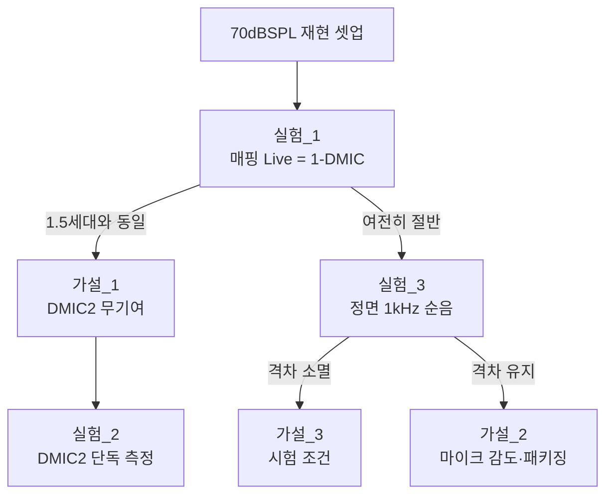

# maxAudioInput 레벨 격차 - 분석

**TL;DR**: `maxAudioInput` 에 이르는 경로에서 **1.5세대와 Sound1 이 다른 곳은 믹싱 단 한 곳뿐**이다. AGC·HEAR 함수체인·입력 시프트(`>>5`)·decimation 이득(GF=1092)·ADC 설정이 모두 동일하고, 빔포밍 믹서의 `>>1` 정규화는 **두 채널이 정면 정렬일 때 1.5세대와 배율 1.00(0dB)로 등가**다. 따라서 -6dB 를 만들 수 있는 것은 **(가) DMIC2(QCC/U9) 채널이 사실상 기여하지 못함** 또는 **(나) 두 마이크 모두 1.5세대 대비 감도가 6dB 낮음** 둘 중 하나이며, **코드 상수·수식 자체는 원인이 아니다.** 이 둘은 매핑 앱 Live 연결만으로(코드 변경 없이) 갈린다.

---

## 1. 신호 경로 전 구간 대조

`Addr_ShareMem->maxAudioInput` 에 값이 도달하기까지의 전 구간을 양쪽 저장소에서 대조했다.


| 구간 | 1.5세대 | Sound1 | 동일? | 근거 |
|---|---|---|---|---|
| 샘플링 주파수 | 16 kHz | 16 kHz | ✅ | `lib_audio_in.c` `LIB_AUDIO_SFCR_16K` |
| decimation 이득 (GF) | 1092 | 1092 | ✅ | `lib_audio_in.h:88` / `lib_audio_in.h:112` |
| ADC CFG (FBDAC·RIN·전류) | 동일 문자열 | 동일 문자열 | ✅ | `lib_audio_in.h:81` / `:105` |
| ADC CTRL (MAX_1P6V 등) | 동일 문자열 | 동일 문자열 | ✅ | `lib_audio_in.h:95` / `:124` |
| DC remove cutoff | 80 Hz | 20 Hz | ⚠️ | `lib_audio_in.h:93` / `:116` - 1 kHz 이상에서 영향 없음 |
| 마이크 구성 | DMIC 1개(`DMIC0_DATA_RE`) + AMIC(이어피스) | **DMIC 2개** (`DMIC0_DATA_RE` + `DMIC2_DATA_FE`) | ❌ | `lib_audio_in.h:73` / `:98` |
| 입력 스케일 시프트 | `>>5` | `>>5` | ✅ | `definitionsForAlgorithm.h:106` / `:103` |
| **믹싱 식** | `mix[i] = mic[i] >> 5` | `mix[i] = ((rear[i]>>5) + (front[i+1]>>5)) >> 1` | ❌ | `audioMixer.c:30-39` / `audioMixer.c:415-435` |
| 2탭 LPF | **비활성**(`= 0`) | 해당 없음 | - | `main.h:28` |
| 믹싱 버퍼 크기 | 16 | 16 | ✅ | `HEAR_AUDIO_MIX_SIZE` |
| HEAR 함수체인 | `vAbsolute(K=16)` -> `MaxElement(K=16)` | 동일 | ✅ | `microcode.hct` (양쪽 동일) |
| abs/max 저장 주소 | `D_HEAR_H4MEM_BASE` | 동일 | ✅ | `microcode.h:74-75` (양쪽 동일) |
| `audio_agc()` 본문 | `input = HEAR_ADDR_...[0]; maxAudioInput = input;` | **문자 단위 동일** | ✅ | `agc.c:94-116` (양쪽 동일) |

> [!IMPORTANT]
> **다른 곳은 마이크 구성과 믹싱 식, 단 두 줄뿐이다.** AGC 계수(rotation point `-6209352`, noise gate `-7700296` 등)도 양쪽이 같아 «AGC 가 다르게 잡는다»는 설명은 성립하지 않는다. 그리고 `maxAudioInput` 은 AGC **입력**이므로 AGC 동작과 무관하게 믹싱 결과가 그대로 실린다.

## 2. 스케일 수식 - 1.5세대 대비 배율

DMIC 원 샘플 진폭을 `A`(Sound1), `M`(1.5세대)이라 하면

$$
\text{1.5세대: } \quad mix = \frac{M}{32}
$$

$$
\text{Sound1 빔포밍: } \quad mix = \frac{1}{2}\left(\frac{A_{rear}}{32} + \frac{A_{front}}{32}\right)
$$

두 채널이 **정면 음원에서 완전 정렬**(빔포밍의 설계 조건)이고 `A_rear = A_front = A` 이면

$$
mix = \frac{1}{2}\cdot\frac{2A}{32} = \frac{A}{32}
$$

즉 **`A = M` 이면 배율 1.00 (0 dB)** - 빔포밍의 `>>1` 은 정면에서 손해가 없다. 두 신호를 더해 얻는 +6 dB 를 다시 -6 dB 해서 0 dB 로 맞추는, 의도된 정규화다(`audioMixer.h:24` `AUDIO_MIX_NORMALIZE_RSHIFT 1`, 선행 리뷰 `20260625_beamforming-impl-review/분석.md:52` 에서도 «단일 마이크와 정합»으로 확인됨).

### 경우별 배율

| 경우 | 결과 | 배율 | dB | 실측(-6dB) 설명? |
|---|---|---|---|---|
| 두 채널 동일 진폭 · 정면 정렬 | `A/32` | 1.00 | 0 | ❌ |
| **한 채널 무신호** | `A/64` | **0.50** | **-6.02** | ✅ **정확히 일치** |
| **두 마이크 감도 6dB 낮음** | `(M/2)/32` | **0.50** | **-6.02** | ✅ **정확히 일치** |
| 두 채널 위상 45° 오정렬 | `0.924A/32` | 0.92 | -0.7 | ❌ |
| 두 채널 위상 90° 오정렬 | `0.707A/32` | 0.71 | -3.0 | ❌ |
| 확산음장(완전 비상관) | `0.707A/32` | 0.71 | -3.0 | ❌ (단독으로는) |
| 두 채널 역상 | `~0` | ~0 | -inf | ❌ |

### 방향·주파수 의존 감쇠 (빔포밍의 정상 동작)

총 지연 1.025 샘플 = **64.06 µs**(SW 1샘플 62.5 µs + HW FRAC=6 → 1.56 µs). 22 mm / 343 m·s = 64.14 µs 와 정합.

정면 이외의 방향에서는 두 채널이 `Δt` 만큼 어긋나고, 합의 배율은 `|cos(π f Δt)|` 가 된다.

| 음원 방향 | 실효 오정렬 `Δt` | 1 kHz | 2 kHz | 4 kHz | null 주파수 |
|---|---|---|---|---|---|
| 정면(end-fire) | 0 µs | 0 dB | 0 dB | 0 dB | 없음 |
| 측면(broadside) | 64.1 µs | -0.2 dB | -0.7 dB | -3.2 dB | **7.8 kHz** |
| 후방 | 128.2 µs | -0.7 dB | -3.2 dB | -28 dB | **3.9 kHz** |

> [!NOTE]
> **1 kHz 순음을 정면에서 넣는 시험이라면 방향·주파수 요인은 -1 dB 미만**이므로 -6 dB 를 설명하지 못한다. 반대로 광대역 신호(스피치 노이즈·핑크 노이즈)를 **측면/후방**에서 넣는 조건이면 고역이 크게 깎여 피크가 눈에 띄게 낮아질 수 있다. **시험 신호의 종류와 음원 방향이 판정의 갈림길**이다.

## 3. 원인 가설과 교차 검토

| 라벨 | 가설 | -6dB 설명력 | 예상되는 특징 | 판정 |
|---|---|---|---|---|
| 가설_1 | **DMIC2(QCC/U9) 채널이 무신호·미약** | ✅ 정확 | 주파수·방향과 **무관하게 일정한 절반**. 1-DMIC 모드로 바꾸면 격차 소멸 | **최유력** |
| 가설_2 | **마이크 감도·음향 패키징**이 1.5세대보다 6dB 낮음 | ✅ 정확 | 역시 일정한 절반이나, **1-DMIC 모드에서도 절반 유지** | **동등 유력** |
| 가설_3 | 시험 음원이 정면이 아니거나 광대역 | △ 부분 | **주파수·방향에 따라 값이 크게 변함**. 정면 1 kHz 로 바꾸면 격차 소멸 | 조건부 |
| 가설_4 | 두 채널 위상 오정렬(SEL 엣지·FRAC·버퍼 인덱스) | ❌ 단독 불가 | 저역은 멀쩡하고 고역만 깎임 | 보조 요인 |
| 가설_5 | 잔향·확산음장의 비상관 성분 | ❌ 단독 불가 | 최대 -3 dB. 무향실이면 거의 0 | 보조 요인 |
| 가설_6 | 코드 상수·수식 오류 | ❌ | - | **배제됨** (§1·§2) |

### 가설_4 관련 - 이미 확인된 사항

`20260623_dmic-sel-edge-match` 에서 SEL 핀과 캡처 엣지의 올바른 조합이 확정됐고(`SEL=GND ↔ _RE`, `SEL=VDD ↔ _FE`), 현행 펌웨어의 `DMIC1=_RE` / `DMIC2=_FE` 는 **U7 SEL=GND · U9 SEL=VDD** 를 요구한다. 이는 후속 `20260625_beamforming-impl-review/분석.md:23` 에서 **«회로도 확인 + `lib_audio_in.c:152`»로 정합 판정**되었다.

> [!WARNING]
> 다만 그 확인은 **회로도(설계) 기준**이다. **실장·솔더링·QCC 측 DMIC_CLK2 점유** 등 보드 개체 수준의 문제는 확인 범위 밖이며, 이것이 가설_1 이 여전히 살아 있는 이유다.

## 4. 판별 실험 설계

가설_1 · 가설_2 · 가설_3 을 가르는 순서다. **실험_1 은 코드 변경이 필요 없다.**

### 실험_1 - 1-DMIC 모드에서 재측정 (코드 변경 없음) ★ 최우선

**방법**: 매핑 앱을 Live 로 연결한 상태에서 같은 70 dBSPL 을 넣고 `maxAudioInput` 을 읽는다.

**원리**: 매핑 Live 연결 중에는 `tdc_enable_1_DMIC()` 가 호출되어(`system_control.c:119`) `tdc_get_enabled_DMIC_count()` 가 1 이 되고, 믹서가 `tdc_audio_mix_1_buffer(DMIC1)` 로 바뀐다(`main.c:478-481`). 이 식 `mix[i] = mic[i] >> 5` 는 **1.5세대와 비트 단위로 동일**하다.

| 결과 | 결론 |
|---|---|
| 1.5세대와 **같은 값** | DMIC1·decimation·HEAR·AGC 정상 → **가설_1 확정**(DMIC2 가 기여하지 못함) |
| 여전히 **절반** | 단일 마이크 경로부터 이미 낮음 → **가설_2 확정**(마이크 감도·음향 패키징) |

### 실험_2 - DMIC2 단독 레벨 직접 측정 (한 줄 임시 변경)

`main.c:490` 의 빔포밍 호출을 임시로 다음으로 바꿔 DMIC2 단독 값을 본다.

```c
tdc_audio_mix_1_buffer((int _XMEM *) &g_lib_dmic_in_buffers[LIB_DMIC_IDX_DMIC2][0][0]);
```

DMIC1 단독(`LIB_DMIC_IDX_DMIC1`)과 번갈아 측정하면 **두 마이크의 상대 감도**가 즉시 나온다. 실험_1 이 가설_1 을 가리킬 때 **어느 정도로 죽었는지**(완전 무신호 vs 미약)를 확정하는 용도다.

### 실험_3 - 시험 신호·방향 통제

1 kHz 순음을 **정면**에서 넣어 재측정한다. 여기서 격차가 사라지면 가설_3(광대역·비정면)이 주원인이며, 이는 **빔포밍의 정상 동작**이므로 결함이 아니다.

### 실험 순서



## 5. 남은 불확실성

| 항목 | 내용 |
|---|---|
| 마이크 부품 대조 | 1.5세대 마이크 모델과 Sound1 의 SPH0641LM4H-1 감도(dBV/Pa) 를 문서로 대조하지 못했다. 가설_2 의 정량 확인에 필요 |
| 시험 셋업 | 은수님 시험의 **신호 종류(순음/광대역)와 음원 방향**이 미확인. 가설_3 판정의 전제 |
| 보드 개체 | U9 SEL 스트랩은 **회로도상** 정합. 실장 개체의 실측은 미확인 |
| 1.5세대 실측 기준값 | «절반»의 기준이 된 1.5세대 수치의 절대값이 기록되지 않아, 재현 시 같은 셋업인지 확인 필요 |

## 6. 부수 확인 - I2S 스트리밍 경로에서도 1-DMIC

`system_control.c:72` 에서 **I2S 스트리밍 중이면 마이크를 1개만 쓴다**(`tdc_enable_1_DMIC()`). 즉 실험_1 은 매핑 Live 외에 **I2S 스트리밍 상태**로도 재현할 수 있다. 다만 이 경로는 믹서가 `tdc_audio_mix_2_buffers_with_gain()` 이 되어 **Gain_A 가 곱해지므로**(`main.c:461`), 게인 인덱스가 유니티(128)인지 먼저 확인해야 한다. 매핑 연결 중에는 두 게인이 유니티로 강제되므로(`main.c:449-458`) **매핑 Live 쪽이 통제하기 쉽다.**
